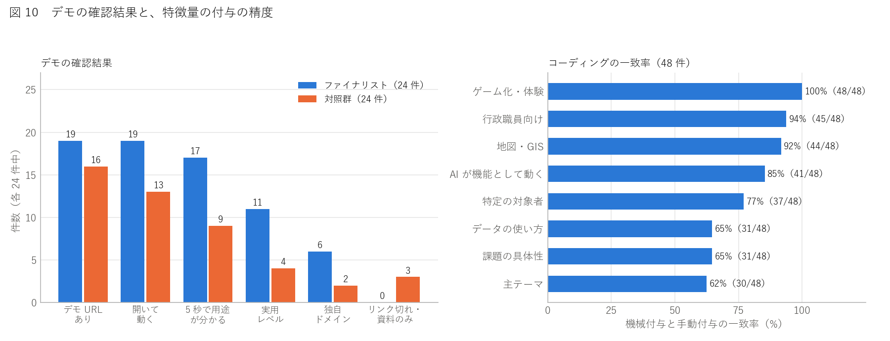
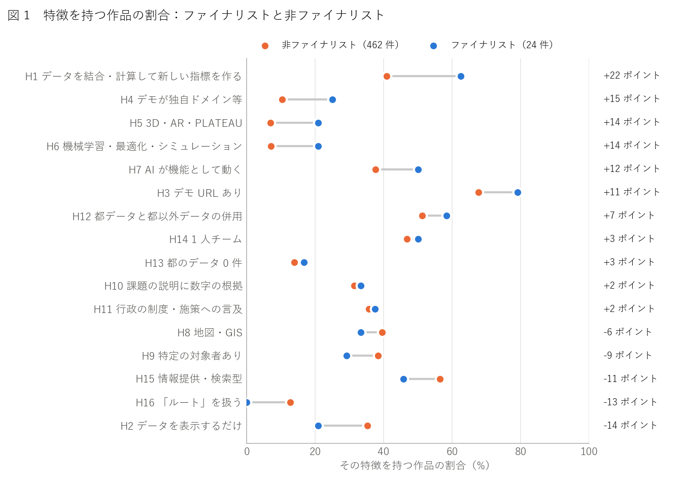
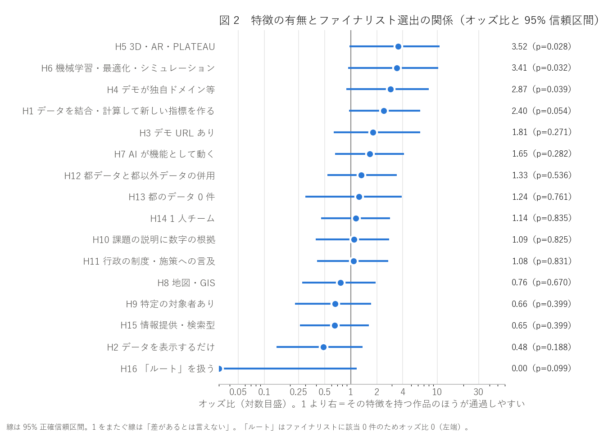
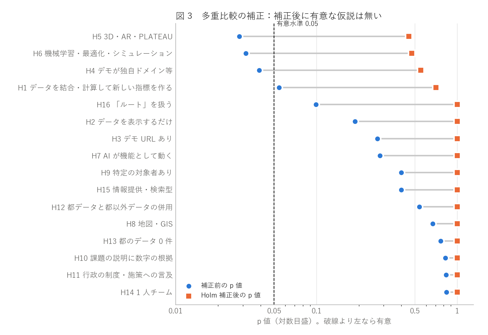
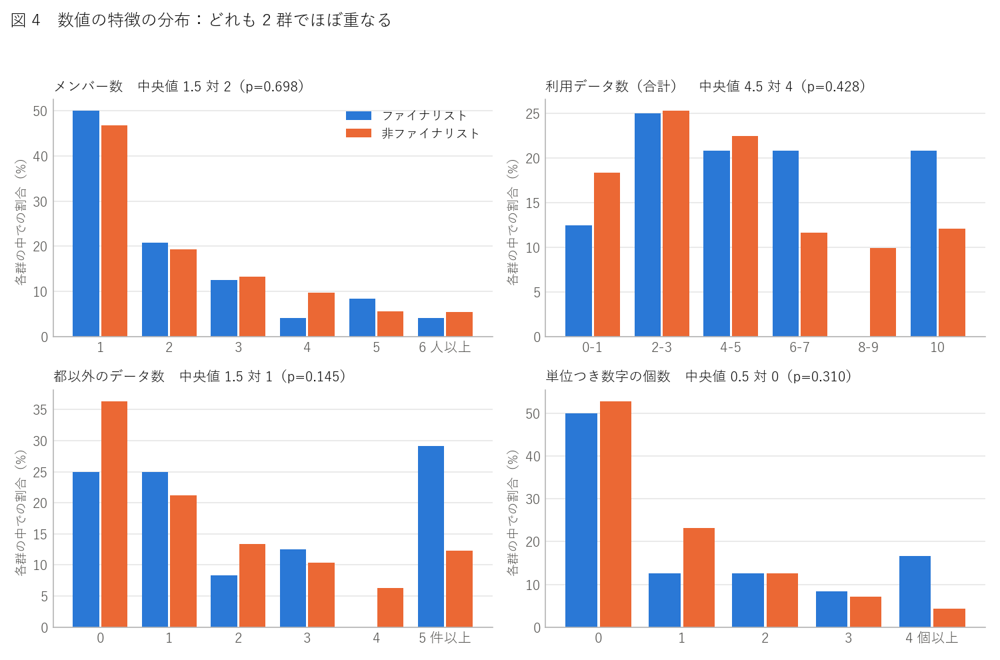
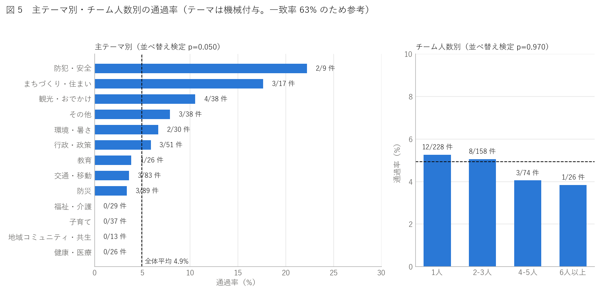
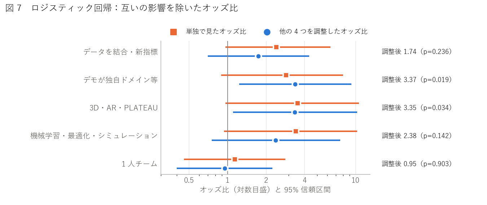
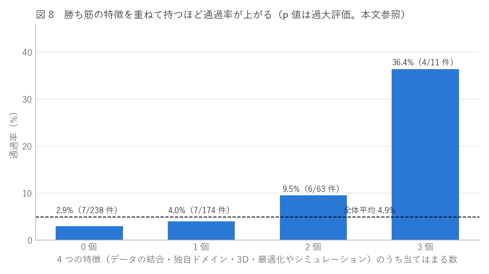
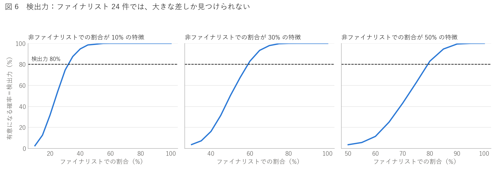
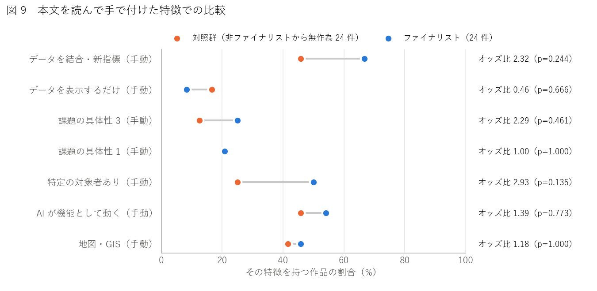

# 勝てるアプリ分析：都知事杯オープンデータ・ハッカソン 2026

- 対象：[2026 年度 提出作品集](https://odhackathon.metro.tokyo.lg.jp/collection/?year=2026)の全 486 作品（取得日 2026-11-21）
- 比べたもの：ファイナリスト 24 作品（＝一次審査を通った「勝てるアプリ」）と、非ファイナリスト 462 作品
- 作品 ID のリンク先は、すべて公式サイトの作品詳細ページ

## 1. 結論

**一次審査の通過率は 4.9%（486 件中 24 件）**。通過は「2 分のプレゼン動画等」で決まる（[募集要項](https://odhackathon.metro.tokyo.lg.jp/recruitment/)）。

先に知っておくべきことが 1 つある。**チームの人数・使ったデータの数・生成 AI を使ったか・地図があるか、といった「形」では、勝敗はほとんど分かれていない**（§4.3）。差が出たのは「データで何を新しく作ったか」と「見せ方」である。

### 勝てるアプリの条件 TOP5

| # | 条件 | 根拠（その特徴を持つ作品の通過率。全体平均は 4.9%） |
|---|---|---|
| 1 | **データを結合・計算して、今まで無かった数字やデータを作っている** | 「結合・新指標」型は 204 件中 15 件＝7.4%。「表示するだけ」型は 168 件中 5 件＝3.0%。「推定」を含む作品は 22 件中 4 件＝18.2% |
| 2 | **技術の見せ場が 1 つ、はっきりある** | 3D・PLATEAU は 37 件中 5 件＝13.5%。最適化・シミュレーションは 38 件中 5 件＝13.2%。画像を読む AI（VLM・Vision）は 6 件中 3 件 |
| 3 | **課題を「自分たちで調べた 1 つの数字」で言い切っている** | 「夜間に使える AED は 105 台中 3 台」「北区の日本語教室の 56% が都の公式一覧に未掲載」など。これは本文を読んでの観察で、集計では裏づけられていない（課題に数字がある作品の割合は 33% 対 31% で差なし。機械では「引用した統計」と「自分で調べた数字」を区別できない）（§7） |
| 4 | **本物のデータで動き、最初の画面で何のアプリか分かる** | デモが独自ドメインの作品は 54 件中 6 件＝11.1%。確認したファイナリストのデモ 19 件はすべて動き、うち 17 件は最初の画面で用途が分かった（§4.4） |
| 5 | **似た作品が少ない切り口を選んでいる** | 水道水の水質×コーヒー、街の誤訳、ヘルプマーク×NFC、詐欺の文面判定など。逆に「ルート」を含む 59 件は通過 0 件 |

### 勝てないアプリの典型 TOP5

| # | 典型 | 根拠 |
|---|---|---|
| 1 | **既にある施設・制度のデータを、探しやすく並べただけ** | 「地図 × データ表示のみ」は 56 件中 0 件。「特定の対象者あり × データ表示のみ」は 70 件中 0 件（対象者の機械付与は精度が低いので参考） |
| 2 | **みんなが思いつく型（ルート案内・施設検索・おすすめ提案・マッチング）** | 「ルート」59 件中 0 件、「施設」84 件中 1 件、「提案」82 件中 2 件、マッチング型 55 件中 1 件 |
| 3 | **デモが無い、または資料・動画・リンク切れ** | デモ URL なしは 154 件中 5 件＝3.2%。Google ドライブ・YouTube・資料類は 14 件中 0 件。対照群ではデモ 16 件中 3 件が動かなかった |
| 4 | **オープンデータの出番が薄い** | 「利用データ 1 件以下 × 2 人以上のチーム」は 41 件中 0 件。「都のデータ 0 件 × デモなし」は 27 件中 0 件 |
| 5 | **機能を盛りすぎて、最初の画面で何のアプリか分からない** | 対照群の動くデモ 13 件のうち 4 件が「5 秒で分からない」。ファイナリストは 19 件中 2 件（§4.4） |

> どの数字も **相関であって因果ではない**。ファイナリストは 24 件しかなく、1〜2 件の入れ替わりで割合は大きく動く。仮説検定（§4.6）では、補正前に有意だったのは「3D」「最適化・シミュレーション」「独自ドメイン」の 3 つだけで、**多重比較の補正後に有意なものは 1 つも無い**。上の表は「統計的に証明された法則」ではなく、「数字と事例の読み込みが同じ向きを指している傾向」として使うこと。使い方は §10 のチェックリスト、限界は §11。

## 2. 調査概要

| 項目 | 内容 |
|---|---|
| 対象 | 都知事杯オープンデータ・ハッカソン 2026 の提出作品集に載っている全作品 |
| 取得日 | 2026-11-21 |
| 件数 | 一覧 486 件（25 ページ＝20 件×24＋6 件）。詳細ページ 486 件を取得（失敗 0 件） |
| 一覧の集め方 | 全 25 ページを 3 巡。2・3 巡目で新しい ID は 0 件、3 巡とも並び順は同じだった |
| ファイナリストの決め方 | (a) カードの「ファイナリスト」表示と、(b) ブラウザでチェックボックスを入れて絞り込んだ一覧。どちらも 24 件で完全に一致 |
| 特徴の付け方 | [コードブック](../codebook.md)をキーワード規則にして、486 件へ機械的に同じ基準で付与 |
| 精度の確認 | ファイナリスト 24 件＋対照群 24 件を、本文を読んで手でも付け、機械付与と比べた（§4.5） |
| デモの確認 | ファイナリスト 24 件＋非ファイナリストから無作為に 24 件（乱数シード 20261121）。デモ URL のある 35 件をブラウザで開いた |
| 定量分析 | [`analysis.ipynb`](../analysis.ipynb) で仮説検定（Fisher の正確検定、Mann-Whitney 検定、並べ替え検定、ロジスティック回帰、多重比較の補正）を実施（§4.6） |
| 審査基準 | [募集要項](https://odhackathon.metro.tokyo.lg.jp/recruitment/)と[審査ページ](https://odhackathon.metro.tokyo.lg.jp/judging/)で確認 |
| していないこと | 2 分プレゼン動画の視聴・文字起こし、過去年度（2021〜2025）との比較 |

事前の想定と違った点：

- 総件数は「約 500 件」ではなく **486 件**
- 掲載順は「ランダム」と書かれているが、取得した時間内では固定だった
- 「サービス内容」は、全作品がほぼ同じ体裁の約 300 字（最短 202 字・最長 390 字）。**主催者側で整形・要約された文章**とみられる。そのため「説明文の書き方のうまさ」は比べられない
- 動画は作品ごとではなく、First Stage の配信アーカイブ 11 本への頭出しリンク。1 作品の持ち時間は約 2 分（頭出し時刻の間隔の中央値 124〜128 秒）
- メンバー氏名は保存していない（人数のみ）

## 3. 基本集計

| 項目 | 件数 |
|---|---|
| 全提出作品 | 486 |
| ファイナリスト | 24（4.9%） |
| 非ファイナリスト | 462 |
| 受賞 | 10（すべてファイナリスト） |

受賞の内訳：都知事杯 1、技術賞 1、データ活用賞 1、ソーシャルインパクト賞 1、サービスデザイン賞 1、オーディエンス賞 1、アイデア賞 2、学生賞 2。

提出作品の全体像：

| 項目 | 値 |
|---|---|
| 1 人チーム | 228 件（47%）。メンバー数の中央値は 2 人 |
| デモ URL あり | 332 件（68%）。デモは任意提出 |
| 画像 3 枚（上限） | 371 件（76%） |
| 生成 AI への言及あり | 446 件（92%） |
| 多い主テーマ | 防災 89、交通・移動 83、行政・政策 51、観光・おでかけ 38、子育て 37 |
| 発表の順番 | ファイナリストは各配信の前半・中盤・後半に 8 件ずつ。順番による有利不利は見られない |

## 4. 観点別の比較

表の見方：**リフト**＝ファイナリスト群での割合 ÷ 非ファイナリスト群での割合。**通過率**＝その特徴を持つ作品のうちファイナリストになった割合（全体平均 4.9%）。Fisher p は参考値で、多くの項目を同時に見ているため 0.05 未満でも偶然の可能性がある。全項目の表は [`data/analysis_tables.md`](../data/analysis_tables.md)。

### 4.1 差が出た特徴（通過率が高い）

| 特徴 | ファイナリスト（24 件中） | 非ファイナリスト（462 件中） | リフト | 通過率 | Fisher p |
|---|---|---|---|---|---|
| 3D・AR・PLATEAU | 5（21%） | 32（7%） | 3.01 | 5/37＝13.5% | 0.028 |
| 機械学習・最適化・シミュレーション | 5（21%） | 33（7%） | 2.92 | 5/38＝13.2% | 0.032 |
| デモが独自ドメイン等 | 6（25%） | 48（10%） | 2.41 | 6/54＝11.1% | 0.039 |
| 解決の形：参加型・投稿 | 5（21%） | 53（11%） | 1.82 | 5/58＝8.6% | 0.189 |
| 解決の形：ゲーム化・体験 | 4（17%） | 44（10%） | 1.75 | 4/48＝8.3% | 0.281 |
| OSM・民間データあり | 8（33%） | 93（20%） | 1.66 | 8/101＝7.9% | 0.126 |
| データの使い方 3（結合・新指標） | 15（62%） | 189（41%） | 1.53 | 15/204＝7.4% | 0.054 |

説明文に出てくる語でも同じ向きの差がある（その語を含む作品の通過率）：

| 語 | ファイナリスト | 非ファイナリスト | 通過率 | Fisher p |
|---|---|---|---|---|
| VLM・Vision（画像を読む AI） | 3 | 3 | 3/6＝50.0% | 0.002 |
| MCP（AI から使える接続口） | 3 | 9 | 3/12＝25.0% | 0.017 |
| 一次（一次資料・一次情報） | 3 | 10 | 3/13＝23.1% | 0.022 |
| 推定 | 4 | 18 | 4/22＝18.2% | 0.018 |
| シミュレ（ーション） | 3 | 15 | 3/18＝16.7% | 0.053 |
| 算出 | 4 | 25 | 4/29＝13.8% | 0.047 |
| 実測・実データ・実在・実際 | 7 | 58 | 7/65＝10.8% | 0.030 |

### 4.2 差が出た特徴（通過率が低い）

| 特徴 | ファイナリスト（24 件中） | 非ファイナリスト（462 件中） | リフト | 通過率 |
|---|---|---|---|---|
| デモが Google ドライブ・YouTube・資料類 | 0 | 14（3%） | 0.00 | 0/14 |
| 解決の形：マッチング | 1（4%） | 54（12%） | 0.36 | 1/55＝1.8% |
| 事業者向け | 1（4%） | 37（8%） | 0.52 | 1/38＝2.6% |
| 運用・持続・展開への言及 | 2（8%） | 66（14%） | 0.58 | 2/68＝2.9% |
| 行政職員向け | 1（4%） | 33（7%） | 0.58 | 1/34＝2.9% |
| データの使い方 1（表示のみ） | 5（21%） | 163（35%） | 0.59 | 5/168＝3.0% |
| デモ URL なし | 5（21%） | 149（32%） | 0.65 | 5/154＝3.2% |
| 解決の形：情報提供・検索 | 11（46%） | 261（56%） | 0.81 | 11/272＝4.0% |

説明文の語（通過率が低いもの）：

| 語 | ファイナリスト | 非ファイナリスト | 通過率 |
|---|---|---|---|
| ルート | 0 | 59 | 0/59 |
| 既存 | 0 | 53 | 0/53 |
| ダッシュボード | 0 | 12 | 0/12 |
| TypeScript | 1 | 126 | 1/127＝0.8% |
| 施設 | 1 | 83 | 1/84＝1.2% |
| React | 2 | 125 | 2/127＝1.6% |
| 防災 | 1 | 55 | 1/56＝1.8% |
| 制度 | 1 | 42 | 1/43＝2.3% |
| 提案 | 2 | 80 | 2/82＝2.4% |
| 支援 | 3 | 113 | 3/116＝2.6% |
| 検索 | 3 | 100 | 3/103＝2.9% |

### 4.3 差が出なかった特徴

「これをやれば有利」と思われがちだが、実際には差が無かったもの。

| 特徴 | ファイナリスト | 非ファイナリスト | リフト |
|---|---|---|---|
| 1 人チーム | 12（50%） | 216（47%） | 1.07 |
| 4 人以上のチーム | 4（17%） | 96（21%） | 0.80 |
| 利用データ 5 件以上 | 12（50%） | 197（43%） | 1.17 |
| 都のデータと都以外のデータの併用 | 14（58%） | 237（51%） | 1.14 |
| 都のデータ URL が 0 件 | 4（17%） | 64（14%） | 1.20 |
| AI が機能として動く | 12（50%） | 174（38%） | 1.33 |
| AI は開発に使っただけ | 12（50%） | 248（54%） | 0.93 |
| 地図・GIS | 8（33%） | 183（40%） | 0.84 |
| 特定の対象者あり | 7（29%） | 177（38%） | 0.76 |
| 課題の説明に数字の根拠あり | 8（33%） | 145（31%） | 1.06 |
| 行政の制度・施策への言及 | 9（38%） | 165（36%） | 1.05 |
| 画像 3 枚 | 19（79%） | 352（76%） | 1.04 |

数値の中央値もほぼ同じ：メンバー数 1.5 人と 2 人、利用データ数 4.5 件と 4 件、説明文 314.5 字と 315.5 字。

「特定の対象者あり」は、手で読んだ 48 件では逆にファイナリストのほうが多かった（12/24 対 6/24）。機械付与の読み落としがあるので、有利とも不利とも言えない（§4.6）。

主テーマ別では、件数の多い防災（89 件中 3 件＝3.4%）、交通・移動（83 件中 3 件＝3.6%）が平均より低く、件数の少ないまちづくり・住まい（17 件中 3 件）、防犯・安全（9 件中 2 件）が高い。ただしテーマの機械付与は手動との一致率が 63% と低く（§4.5）、**テーマによる有利不利は言い切れない**。機械付与では子育て・福祉・健康が主テーマの 92 件から通過 0 件だが、本文を読むと[ピコまる](https://odhackathon.metro.tokyo.lg.jp/collection/6629128700713418633/?year=2026)（障害のある子）、[HEART2NFC](https://odhackathon.metro.tokyo.lg.jp/collection/6632803203416697322/?year=2026)（ヘルプマーク）、[Family Compass](https://odhackathon.metro.tokyo.lg.jp/collection/6632783666304021053/?year=2026)（子育て家庭）などがこの領域に当たる。

### 4.4 デモ（モック）の確認結果

ファイナリスト 24 件と、非ファイナリストから無作為に選んだ対照群 24 件。個別の記録とスクリーンショットは [`data/mock/`](../data/mock/)、一覧は [`data/mock_summary.csv`](../data/mock_summary.csv)。

| 項目 | ファイナリスト（24） | 対照群（24） |
|---|---|---|
| デモ URL あり | 19 | 16 |
| 開いて動く | 19 | 13 |
| リンク切れ・エラー | 0 | 2 |
| 資料・動画のみ | 0 | 1 |
| 最初の画面で、何のアプリか 5 秒で分かる | 17 | 9 |
| 動くが、5 秒では分からない | 2 | 4 |
| 実用レベル（実データ・主要導線が動く・説明なしで使える） | 11 | 4 |
| 独自ドメインで公開 | 6 | 2 |
| 主要機能が 5 つ以上 | 4 | 5 |

Fisher の正確検定（24 件 対 24 件。参考値）：「5 秒で用途が分かる」17 対 9 で p＝0.041、「実用レベル」11 対 4 で p＝0.060、「開いて動く」19 対 13 で p＝0.125、「デモ URL あり」19 対 16 で p＝0.517。差が一番はっきりしているのは **最初の画面の分かりやすさ** である。

読み取れること：

- **ファイナリストのデモは 1 件も壊れていなかった**。対照群は 16 件中 3 件が動くアプリではなかった
- ファイナリストでもデモ URL なしが 5 件ある（[RISQ 365](https://odhackathon.metro.tokyo.lg.jp/collection/6609456889769841227/?year=2026)、[みらい交通図](https://odhackathon.metro.tokyo.lg.jp/collection/6628822313851554196/?year=2026)、[データを、点から疑似体験へ](https://odhackathon.metro.tokyo.lg.jp/collection/6632574456226309556/?year=2026)、[Metropolitan Passive Design Simulator](https://odhackathon.metro.tokyo.lg.jp/collection/6632697328647958016/?year=2026)、[HEART2NFC](https://odhackathon.metro.tokyo.lg.jp/collection/6632803203416697322/?year=2026)）。**デモは必須ではない**が、この 5 件はいずれも 3D・シミュレーション・画像解析・ハードウェアなど、動画で見せられる技術を持つ
- 対照群にも完成度の高いデモは多い（[スミハジメ](https://odhackathon.metro.tokyo.lg.jp/collection/6630478628913937447/?year=2026)、[旬環](https://odhackathon.metro.tokyo.lg.jp/collection/6630437322029407764/?year=2026)、[東京領収書](https://odhackathon.metro.tokyo.lg.jp/collection/6630851843427932010/?year=2026)）。**出来が良いだけでは通らない**
- 注意：確認したのは 2026-11-21 時点の画面で、審査時点（8 月末）の状態ではない。ファイナリストは審査後も開発を続けている（都知事杯作品のサイトには受賞の表記がある）ので、「実用レベル」の差は通過の結果である可能性がある

### 4.5 コーディングの精度（二重コーディング）

機械付与と、本文を読んで手で付けたものの一致率。手で付けた結果は [`data/manual_coding.csv`](../data/manual_coding.csv)。

| 観点 | 48 件での一致 | うちファイナリスト 24 件 |
|---|---|---|
| ゲーム化・体験 | 48/48（100%） | 24/24（100%） |
| 行政職員向け | 45/48（94%） | 23/24（96%） |
| 地図・GIS | 44/48（92%） | 21/24（88%） |
| AI が機能として動く | 41/48（85%） | 21/24（88%） |
| 特定の対象者あり | 37/48（77%） | 17/24（71%） |
| データの使い方（3 段階） | 31/48（65%） | 18/24（75%） |
| 課題の具体性（3 段階） | 31/48（65%） | 15/24（63%） |
| 主テーマ | 30/48（63%） | 17/24（71%） |

技術・形式の項目は 85% 以上で信頼できる。**テーマ・課題の具体性・データの使い方は 65% 前後**で、キーワードでは読み違いが多い。これらに関する主張は、§5〜§7 の個別事例の読み込みを併せて見ること。なお、手動の付与は機械付与の結果を見たあとに行ったので、完全に独立ではない。

### 4.6 仮説検定

定量分析は [`analysis.ipynb`](../analysis.ipynb) にまとめた（実行済み。出力つき）。ここにはその結果を残す。

**方法**

| 項目 | 決めたこと |
|---|---|
| 帰無仮説 | 「その特徴の有無と、ファイナリストに選ばれるかどうかは無関係」 |
| 二値の特徴 | Fisher の正確検定（両側）。期待度数が 5 を下回るセルが多いので、カイ二乗検定は使わない |
| 効果の大きさ | オッズ比（条件付き最尤推定）と 95% 正確信頼区間 |
| 数値の特徴 | Mann-Whitney の U 検定（両側） |
| 多カテゴリ | カイ二乗統計量の並べ替え検定（10 万回） |
| 有意水準・多重比較 | 5%。16 個の仮説を同時に検定するので、Holm 法と Benjamini-Hochberg 法（BH）で補正 |
| 仮説の性質 | H1〜H16 はコードブックの観点から立てたが、データを一度集計したあとに確定した。**探索的な検定**であり、事前登録された検証ではない |

**結果（二値の特徴。オッズ比が 1 より大きい＝その特徴を持つ作品のほうが通過しやすい）**

| 仮説 | 特徴 | 予想 | ファイナリスト | 非ファイナリスト | オッズ比（95% 信頼区間） | p 値 | Holm 補正後 | BH 補正後 | 判定 |
|---|---|---|---|---|---|---|---|---|---|
| H5 | 3D・AR・PLATEAU | ＋ | 5/24（21%） | 32/462（7%） | 3.52（0.96〜10.63） | 0.028 | 0.454 | 0.210 | 補正前のみ有意 |
| H6 | 機械学習・最適化・シミュレーション | ＋ | 5/24（21%） | 33/462（7%） | 3.41（0.93〜10.26） | 0.032 | 0.473 | 0.210 | 補正前のみ有意 |
| H4 | デモが独自ドメイン等 | ＋ | 6/24（25%） | 48/462（10%） | 2.87（0.89〜8.01） | 0.039 | 0.550 | 0.210 | 補正前のみ有意 |
| H1 | データを結合・計算して新しい指標を作る | ＋ | 15/24（63%） | 189/462（41%） | 2.40（0.96〜6.37） | 0.054 | 0.705 | 0.217 | 有意でない |
| H3 | デモ URL あり | ＋ | 19/24（79%） | 313/462（68%） | 1.81（0.64〜6.31） | 0.271 | 1.000 | 0.563 | 有意でない |
| H7 | AI が機能として動く | ＋ | 12/24（50%） | 174/462（38%） | 1.65（0.66〜4.12） | 0.282 | 1.000 | 0.563 | 有意でない |
| H12 | 都データと都以外データの併用 | ＋ | 14/24（58%） | 237/462（51%） | 1.33（0.54〜3.42） | 0.536 | 1.000 | 0.780 | 有意でない |
| H13 | 都のデータ 0 件 | − | 4/24（17%） | 64/462（14%） | 1.24（0.30〜3.88） | 0.761 | 1.000 | 0.835 | 有意でない（予想と逆向き） |
| H14 | 1 人チーム | − | 12/24（50%） | 216/462（47%） | 1.14（0.46〜2.83） | 0.835 | 1.000 | 0.835 | 有意でない（予想と逆向き） |
| H10 | 課題の説明に数字の根拠 | ＋ | 8/24（33%） | 145/462（31%） | 1.09（0.40〜2.78） | 0.825 | 1.000 | 0.835 | 有意でない |
| H11 | 行政の制度・施策への言及 | ＋ | 9/24（38%） | 165/462（36%） | 1.08（0.41〜2.70） | 0.831 | 1.000 | 0.835 | 有意でない |
| H8 | 地図・GIS | ＋ | 8/24（33%） | 183/462（40%） | 0.76（0.28〜1.94） | 0.670 | 1.000 | 0.835 | 有意でない（予想と逆向き） |
| H9 | 特定の対象者あり | ＋ | 7/24（29%） | 177/462（38%） | 0.66（0.23〜1.72） | 0.399 | 1.000 | 0.639 | 有意でない（予想と逆向き） |
| H15 | 情報提供・検索型 | − | 11/24（46%） | 261/462（56%） | 0.65（0.26〜1.62） | 0.399 | 1.000 | 0.639 | 有意でない |
| H2 | データを表示するだけ | − | 5/24（21%） | 163/462（35%） | 0.48（0.14〜1.37） | 0.188 | 1.000 | 0.501 | 有意でない |
| H16 | 「ルート」を扱う | − | 0/24（0%） | 59/462（13%） | 0.00（0.00〜1.17） | 0.099 | 1.000 | 0.317 | 有意でない |

**結論**

- **補正前に有意（p < 0.05）なのは 3 つ**：3D・AR・PLATEAU（H5）、機械学習・最適化・シミュレーション（H6）、デモが独自ドメイン等（H4）。データの結合・新指標（H1）は p＝0.054 で境界
- **多重比較の補正後に有意な仮説は 1 つも無い**（Holm 法でも BH 法でも）。上の 3 つは信頼区間の下限も 1 をわずかに下回る。つまり統計的には、**どの特徴も「確かに効く」とまでは言えない**
- 予想と向きが逆だった仮説が 4 つある（地図、特定の対象者、都のデータ 0 件、1 人チーム）。いずれも有意ではなく、「有利でも不利でもない」と読むのが妥当

**その他の検定**

| 検定 | 結果 | 読み方 |
|---|---|---|
| 数値 8 項目の Mann-Whitney 検定（メンバー数、利用データ数、都のデータ数、都以外のデータ数、数字の個数、文字数、テーマ数、タイトル文字数） | すべて p ≧ 0.145（図 4） | 量では差が出ない |
| 主テーマ（13 区分）の並べ替え検定 | 統計量 20.34、p＝0.050 | 境界。テーマの機械付与は一致率 63% なので、言い切らない |
| チーム人数帯（4 区分）の並べ替え検定 | 統計量 0.23、p＝0.970 | 人数は関係ない |
| ロジスティック回帰（H1・H4・H5・H6・H14 を同時に投入） | 尤度比検定 χ²＝14.18、自由度 5、p＝0.015。調整オッズ比：独自ドメイン 3.37（1.23〜9.26、p＝0.019）、3D 3.35（1.10〜10.27、p＝0.034）、最適化等 2.38（p＝0.142）、データ結合 1.74（p＝0.236）、1 人 0.95（p＝0.903） | 互いの影響を除いても、独自ドメインと 3D の効果は残る。ただし 1 変数あたりファイナリスト約 5 件で、推定は不安定 |
| 勝ち筋の特徴（データ結合・独自ドメイン・3D・最適化等）を持つ個数と通過率の傾向 | 0 個：238 件中 7 件（2.9%）、1 個：174 件中 7 件（4.0%）、2 個：63 件中 6 件（9.5%）、3 個：11 件中 4 件（36.4%）。並べ替え検定 p＝0.0002 | 重ねて持つほど通過率が上がる。**ただし結果が良かった特徴を選んで組んだスコアなので、p 値は過大評価**。別の年度で確かめるまでは仮説 |

**検出力（この件数で見つけられる差の大きさ）**

ファイナリストが 24 件のとき、Fisher の正確検定で 80% の確率で有意になるには、次の差が要る（シミュレーション）。

| 非ファイナリストでの割合 | 必要なファイナリストでの割合 | 必要なリフト |
|---|---|---|
| 10% | 32% | 3.2 倍 |
| 30% | 60% | 2.0 倍 |
| 50% | 80% | 1.6 倍 |

つまり **「有意でない」は「差が無い」ではなく、「この件数では差があるとは言えない」** という意味である。リフト 1.5 倍程度の差（例：データの結合 1.53）は、本当にあっても今回の件数では検出しにくい。

**手動コーディングでの確認（ファイナリスト 24 件 対 対照群 24 件）**

| 特徴（手動） | ファイナリスト | 対照群 | オッズ比 | p 値 | 機械付与と同じ向きか |
|---|---|---|---|---|---|
| データを結合・新指標 | 16/24 | 11/24 | 2.32 | 0.244 | 同じ（機械 2.40） |
| データを表示するだけ | 2/24 | 4/24 | 0.46 | 0.666 | 同じ（機械 0.48） |
| 課題の具体性 3 | 6/24 | 3/24 | 2.29 | 0.461 | 同じ（機械 1.39） |
| AI が機能として動く | 13/24 | 11/24 | 1.39 | 0.773 | 同じ（機械 1.65） |
| 地図・GIS | 11/24 | 10/24 | 1.18 | 1.000 | 逆（機械 0.76）。どちらも 1 に近い |
| 特定の対象者あり | 12/24 | 6/24 | 2.93 | 0.135 | **逆（機械 0.66）** |

データの使い方（H1・H2）は、手で読んでも同じ向き・同じ大きさで、機械付与の読み違いによるものではない。一方「特定の対象者」は機械と手動で向きが逆になった。キーワードでは「体調に波がある人」「ヘルプマーク利用者」「ろう者・難聴者」のような対象を拾えていないためで、**この特徴については結論を出さない**。

## 5. 勝ちパターンと代表事例

### 5.1 組み合わせ（2 つの特徴を同時に持つ作品の通過率）

該当 12 件以上・ファイナリスト 3 件以上のものから。全体平均は 4.9%。

| 組み合わせ | 該当数 | うちファイナリスト | 通過率 |
|---|---|---|---|
| 課題に数字 × 3D | 13 | 3 | 23.1% |
| 特定の対象者 × ゲーム化 | 14 | 3 | 21.4% |
| 最適化・シミュレーション × 1 人 | 24 | 5 | 20.8% |
| 3D × 意思決定支援 | 21 | 4 | 19.0% |
| 独自ドメイン × データ量の大きな数字 | 16 | 3 | 18.8% |
| データ結合・新指標 × 参加型 | 24 | 4 | 16.7% |
| 課題の具体性 3 × データ結合・新指標 | 32 | 5 | 15.6% |
| データ結合・新指標 × 最適化・シミュレーション | 33 | 5 | 15.2% |
| 独自ドメイン × 基盤・API | 20 | 3 | 15.0% |

### 5.2 パターン A：データから「新しいものさし」を作る

データを並べるのではなく、計算して今まで無かった指標を出す型。

| 作品 | 作ったものさし |
|---|---|
| [さんぽの一歩](https://odhackathon.metro.tokyo.lg.jp/collection/6628329957519869346/?year=2026) | 休める場所が無いまま歩き続ける最長区間「とぎれ」 |
| [夜間救命 AED 最適配置プランナー](https://odhackathon.metro.tokyo.lg.jp/collection/6632784350521207538/?year=2026) | 予算内で救命期待数が最大になる施策の組み合わせ |
| [土地プライス](https://odhackathon.metro.tokyo.lg.jp/collection/6620896292228979400/?year=2026) | 登記・用途地域・公示地価だけから出す推定地価 |
| [地震火災シミュレータ](https://odhackathon.metro.tokyo.lg.jp/collection/6624153857119864819/?year=2026) | 道路で区切った「延焼クラスター」 |
| [東京 RPG](https://odhackathon.metro.tokyo.lg.jp/collection/6632592270313775458/?year=2026) | 混雑の推定値を、ゲームの「レア度」に変換 |
| [TOKYO WATER SOMMELIER AI](https://odhackathon.metro.tokyo.lg.jp/collection/6632737540318502491/?year=2026) | 給水栓ごとの水質から出すコーヒーの抽出レシピ |

### 5.3 パターン B：オープンデータそのものを作って配る

アプリではなく、他の人や AI が使えるデータ基盤を出す型。24 件中 3 件で、**3 件とも受賞**している。

| 作品 | 作ったデータ | 賞 |
|---|---|---|
| [みちよみ](https://odhackathon.metro.tokyo.lg.jp/collection/6631880520316969093/?year=2026) | 街路写真を AI が言葉にした 588,220 地点・13 年分 | 都知事杯 |
| [Queria](https://odhackathon.metro.tokyo.lg.jp/collection/6630014324117198346/?year=2026) | 公的統計を、そのまま集計できるデータベースとして公開 | 技術賞 |
| [風土記](https://odhackathon.metro.tokyo.lg.jp/collection/6632806743562514559/?year=2026) | 自治体の予算・決算を事業単位まで構造化し標準形式で配布 | データ活用賞 |

3 件とも API・MCP で AI から使える。非ファイナリストにも「基盤・プラットフォーム」を名乗る作品は多い（基盤・API 型は 129 件中 7 件＝5.4% で平均並み）。違いは、**構想ではなく実データが入って動いている**点である（「基盤・API × デモなし」は 52 件中 1 件）。

### 5.4 パターン C：ばらばらの情報を、一次資料に当たって 1 つにまとめる

「探しやすく並べる」型は負けやすい（§6）が、**元のデータが存在しない・不完全なところを自分たちで埋めた**ものは通っている。

| 作品 | 埋めたもの |
|---|---|
| [たぶんかコンパス](https://odhackathon.metro.tokyo.lg.jp/collection/6632265521322646040/?year=2026) | 23 区市町村の PDF・HTML から日本語教室を抽出し、一次資料と人手で突き合わせ |
| [Family Compass](https://odhackathon.metro.tokyo.lg.jp/collection/6632783666304021053/?year=2026) | 都内 62 自治体の制度 745 件・相談窓口 286 件を一次情報から整備 |
| [ピコまる](https://odhackathon.metro.tokyo.lg.jp/collection/6629128700713418633/?year=2026) | 施設データに「その子のプロフィール」を重ね、使える設備だけに印 |

### 5.5 パターン D：行動を変えさせる仕掛け（ゲーム・参加）

| 作品 | 仕掛け |
|---|---|
| [RISQ 365](https://odhackathon.metro.tokyo.lg.jp/collection/6609456889769841227/?year=2026) | 部屋の写真からリスクを「ドラゴン」にし、対策すると封印できる |
| [檜原村 3D 探検シリーズ](https://odhackathon.metro.tokyo.lg.jp/collection/6632806081015309631/?year=2026) | 実際の地形を 3D にしたゲームで、観光と獣害対策を体験 |
| [TIUC](https://odhackathon.metro.tokyo.lg.jp/collection/6632790921012424821/?year=2026) | 街の誤った外国語表記を、撮る→判定→修正の 3 段階で市民が直す |
| [みえる公共情報](https://odhackathon.metro.tokyo.lg.jp/collection/6631337448914771462/?year=2026) | バスの運行状況を市民が文字で投稿し、他の人の反応で信頼度を出す |

### 5.6 全ファイナリストの読み込み（なぜ選ばれたと考えられるか）

以下は本文とデモを読んだうえでの **解釈** である。

| 作品 | なぜ選ばれたと考えられるか |
|---|---|
| [みちよみ](https://odhackathon.metro.tokyo.lg.jp/collection/6631880520316969093/?year=2026)（都知事杯） | §7 |
| [Queria](https://odhackathon.metro.tokyo.lg.jp/collection/6630014324117198346/?year=2026)（技術賞） | §7 |
| [風土記](https://odhackathon.metro.tokyo.lg.jp/collection/6632806743562514559/?year=2026)（データ活用賞） | §7 |
| [みえる公共情報](https://odhackathon.metro.tokyo.lg.jp/collection/6631337448914771462/?year=2026)（ソーシャルインパクト賞） | §7 |
| [TOKYO WATER SOMMELIER AI](https://odhackathon.metro.tokyo.lg.jp/collection/6632737540318502491/?year=2026)（サービスデザイン賞） | §7 |
| [Family Compass](https://odhackathon.metro.tokyo.lg.jp/collection/6632783666304021053/?year=2026)（オーディエンス賞） | §7 |
| [たぶんかコンパス](https://odhackathon.metro.tokyo.lg.jp/collection/6632265521322646040/?year=2026)（アイデア賞） | §7 |
| [HEART2NFC](https://odhackathon.metro.tokyo.lg.jp/collection/6632803203416697322/?year=2026)（アイデア賞） | §7 |
| [放課後 Hub](https://odhackathon.metro.tokyo.lg.jp/collection/6632742521025822288/?year=2026)（学生賞） | §7 |
| [檜原村 3D 探検シリーズ](https://odhackathon.metro.tokyo.lg.jp/collection/6632806081015309631/?year=2026)（学生賞） | §7 |
| [夜間救命 AED 最適配置プランナー](https://odhackathon.metro.tokyo.lg.jp/collection/6632784350521207538/?year=2026) | 「105 台中、夜に使えるのは 3 台」という 1 つの数字で課題が伝わる。予算を動かすと答えが変わる画面で、行政がそのまま使う姿が見える。計算は数理最適化、AI は文書の下書きだけ、と役割を分けている |
| [土地プライス](https://odhackathon.metro.tokyo.lg.jp/collection/6620896292228979400/?year=2026) | 「地図をクリックすると価格が出る」だけで、説明が要らない。数万円・数週間かかる鑑定を無料・数秒にするという差が分かりやすい。オープンデータだけで作ったと明言 |
| [地震火災シミュレータ](https://odhackathon.metro.tokyo.lg.jp/collection/6624153857119864819/?year=2026) | 能登の「1 件の火災が 240 棟」という実例から入り、町丁目単位の想定を「自分の家と街区」まで下ろした。絶対的な予測ではなく相対評価だと限界を明示し、助成情報へつなぐ |
| [さんぽの一歩](https://odhackathon.metro.tokyo.lg.jp/collection/6628329957519869346/?year=2026) | 実体験から出た「距離ではなく、休める間隔で選ぶ」という見方の転換。「とぎれ」という新しい指標に名前を付けた |
| [みらい交通図](https://odhackathon.metro.tokyo.lg.jp/collection/6628822313851554196/?year=2026) | 全車両を 1 秒ごとに動かす物理シミュレーションという技術の規模。10 種のデータを同化し、平時の混雑予測と災害時の避難を 1 つの画面でつないだ |
| [ピコまる](https://odhackathon.metro.tokyo.lg.jp/collection/6629128700713418633/?year=2026) | 「この子が行けるか、という一行が足りない」という課題の言い方が鋭い。おでかけが避難の予習になるという二重の価値。AI を 2 か所に限定し、運営法人・方針まで整えた実用度 |
| [Wild Alert](https://odhackathon.metro.tokyo.lg.jp/collection/6631741092419438587/?year=2026) | クマ出没という時事性の高い題材で、似た作品が少ない。過去の出没×気象でリスクを予測し、住民と自治体の両方に使い道がある |
| [データを、点から疑似体験へ](https://odhackathon.metro.tokyo.lg.jp/collection/6632574456226309556/?year=2026) | 事故の「点」を 3D の現場に変える、というタイトルどおりの一点突破。坂や建物の影まで再現し、交通安全教材という使い先が具体的 |
| [東京 RPG](https://odhackathon.metro.tokyo.lg.jp/collection/6632592270313775458/?year=2026) | 「混雑を見せても 36% しか見ない」という調査から、混雑を経験値に変える設計を導いた。課題→仕組みの筋が通っている |
| [Metropolitan Passive Design Simulator](https://odhackathon.metro.tokyo.lg.jp/collection/6632697328647958016/?year=2026) | 3D 都市モデルで日照と風を解析し、窓や庇の処方と光熱費の削減額まで出す。重い流体計算を画像認識 AI で置き換えるという技術の工夫 |
| [サギカモ](https://odhackathon.metro.tokyo.lg.jp/collection/6632782773246180377/?year=2026) | 「不審な連絡を受けた瞬間」という場面が具体的。AI の判定に警視庁の認知件数を根拠として添え、断定しない出力にした。家族への共有まで設計 |
| [TIUC](https://odhackathon.metro.tokyo.lg.jp/collection/6632790921012424821/?year=2026) | 街の誤訳という、誰も扱っていない題材。AI 翻訳が原因の問題を、人の判断で直すという逆張り。実際の投稿数が画面に出ている |
| [TOKYO NEXT](https://odhackathon.metro.tokyo.lg.jp/collection/6632806512249701106/?year=2026) | 対象を観光の「リピーター」に絞り、「空いているから」ではなく「好きだから行く」という動機に言い換えた。来訪データを都の観光施策に返す構想 |
| [RISQ 365](https://odhackathon.metro.tokyo.lg.jp/collection/6609456889769841227/?year=2026) | 写真 1 枚で自分の部屋のリスクが出る手軽さと、「ドラゴン封印」の楽しさ。対策の根拠に公的データを使い、10 種のデータを挙げている。8 人チーム |

## 6. 負けパターンと代表事例

ここに挙げる作品の出来が悪いという意味ではない。**同じ型の作品が多く、差が付きにくかった**例として示す。

### 6.1 特定の人向けに、既存の施設・制度データを探しやすくしただけ

- 根拠：「特定の対象者あり × データ表示のみ」70 件中 0 件。「地図 × データ表示のみ」56 件中 0 件。「施設」84 件中 1 件、「制度」43 件中 1 件
- 例：[まるっと病児保育](https://odhackathon.metro.tokyo.lg.jp/collection/6606859991762833202/?year=2026)（4 区の施設データを横断検索）、[マチマド](https://odhackathon.metro.tokyo.lg.jp/collection/6632296912522206720/?year=2026)（子育て支援制度を AI が整理）、[はぐくみ](https://odhackathon.metro.tokyo.lg.jp/collection/6632791503611063817/?year=2026)（子育て支援制度を 3 タップで抽出）
- 同じ子育て支援制度を扱った [Family Compass](https://odhackathon.metro.tokyo.lg.jp/collection/6632783666304021053/?year=2026) は通過している。違いは、対象を「夫婦関係が揺れる家族」まで絞ったこと、制度名ではなく「いまの状況」から入ること、745 件を一次情報から自分たちで整備したことである

### 6.2 みんなが思いつく型（ルート・避難・おでかけ提案）

- 根拠：「ルート」59 件中 0 件、「提案」82 件中 2 件、「避難」67 件中 2 件、「熱中症・暑さ」39 件中 1 件
- 例：[だれでも避難ナビ TOKYO](https://odhackathon.metro.tokyo.lg.jp/collection/6595711107325360555/?year=2026)（データ 10 件を使う丁寧な作りだが、避難ナビは数が多い）、[UV かけいぼ](https://odhackathon.metro.tokyo.lg.jp/collection/6607716898916603923/?year=2026)（日陰ルート）、[まもチャリ東京](https://odhackathon.metro.tokyo.lg.jp/collection/6631820005012029985/?year=2026)（自転車ルート）、[東京いくみ](https://odhackathon.metro.tokyo.lg.jp/collection/6632792855438126616/?year=2026)（おでかけ先の提案）

### 6.3 デモが無い・壊れている・資料だけ

- 根拠：デモ URL なし 154 件中 5 件＝3.2%。Google ドライブ・YouTube・資料類 14 件中 0 件。GitHub Pages 12 件中 0 件
- 例：[都民健康ナビ](https://odhackathon.metro.tokyo.lg.jp/collection/6632764711017025305/?year=2026)（Google ドライブに動画 1 本）、[TOKYO QUEST](https://odhackathon.metro.tokyo.lg.jp/collection/6632648138016309885/?year=2026)（デモが 404）、[はぐくみ](https://odhackathon.metro.tokyo.lg.jp/collection/6632791503611063817/?year=2026)（公開ページが消えている）
- リンク切れは取得日（11 月）時点の状態で、審査時に動いていたかは分からない

### 6.4 機能を盛りすぎ・最初の画面で用途が伝わらない

- 根拠：対照群の動くデモ 13 件中 4 件が「5 秒で分からない」
- 例：[TOKYO OPEN DATA COMPASS](https://odhackathon.metro.tokyo.lg.jp/collection/6627022870027486713/?year=2026)（音声・地図・防災・交通・歴史・意見収集を 1 つに）、[CROWD WEATHER](https://odhackathon.metro.tokyo.lg.jp/collection/6630644508737130488/?year=2026)（主催者・来場者・スタッフの 3 画面）、[社会参加](https://odhackathon.metro.tokyo.lg.jp/collection/6632839142607576668/?year=2026)（「政治意見の量子化」という言葉から用途が掴みにくい。利用データ欄も空）

### 6.5 オープンデータの出番が薄い

- 根拠：「利用データ 1 件以下 × 2 人以上」41 件中 0 件。「データ表示のみ × 利用データ 1 件以下」34 件中 0 件。「都のデータ 0 件 × デモなし」27 件中 0 件
- 例：[とどくワード](https://odhackathon.metro.tokyo.lg.jp/collection/6628550660614714627/?year=2026)（LLM で検索キーワードを提案。データは課題の裏づけに 1 件）、[Policy Spotlight](https://odhackathon.metro.tokyo.lg.jp/collection/6632584103412573991/?year=2026)（アンケート 1 件。データ入力は未実装と明記）

### 6.6 良い作品でも落ちる

対照群には、ファイナリストと見分けが付かない水準の作品がある。[スミハジメ](https://odhackathon.metro.tokyo.lg.jp/collection/6630478628913937447/?year=2026)（332 件の一次ソース台帳、179 問の自動評価で誤答 0）、[旬環](https://odhackathon.metro.tokyo.lg.jp/collection/6630437322029407764/?year=2026)（市場日報 423 万行を解析）、[そだちマップ](https://odhackathon.metro.tokyo.lg.jp/collection/6632340472392124106/?year=2026)（1,012 人調査の 47.4% から課題を設定）。**通過率 5% の審査では、条件を満たしても落ちることのほうが多い**。

## 7. 受賞作の深掘り

| 賞 | 作品 | 何をしたか | 効いたと考えられる点（解釈） |
|---|---|---|---|
| 都知事杯 | [みちよみ](https://odhackathon.metro.tokyo.lg.jp/collection/6631880520316969093/?year=2026)（1 人） | 市民が撮った街路写真を AI が言葉にし、588,220 地点・13 年分を「座標×テキスト」のデータとして配信。人は地図で、AI は API・MCP で同じデータを引く | ①「道の形は台帳にあるが、状態は誰も記録していない」というデータの空白を見つけた。②その空白を埋めるデータを自分で作った。③別の AI に反証させ、通った 2,522 件だけ載せるという検証の手順を持つ。④登録不要で誰でもすぐ使える完成度 |
| 技術賞 | [Queria](https://odhackathon.metro.tokyo.lg.jp/collection/6630014324117198346/?year=2026)（3 人） | オープンデータをファイルではなく、そのまま集計できるデータベースとして公開 | 集計サーバーを持たず、利用者側で計算させて運用費を抑える設計。技術の選び方に理由がある |
| データ活用賞 | [風土記](https://odhackathon.metro.tokyo.lg.jp/collection/6632806743562514559/?year=2026)（1 人） | 自治体の予算・決算を事業単位まで構造化し、国際標準の形式で配布 | PDF でしか読めなかったものを機械で読めるデータにした。米国の先行例（Open States）を示し、位置づけが明確。OSS として公開 |
| ソーシャルインパクト賞 | [みえる公共情報](https://odhackathon.metro.tokyo.lg.jp/collection/6631337448914771462/?year=2026)（1 人） | バスの運行状況を市民が文字で投稿・確認 | 「音声アナウンスが聞こえない人」という、はっきりした当事者。使ったデータは 1 件だけ。データの数より、誰の何を解くかが評価された例 |
| サービスデザイン賞 | [TOKYO WATER SOMMELIER AI](https://odhackathon.metro.tokyo.lg.jp/collection/6632737540318502491/?year=2026)（2 人） | 住所の水質から、コーヒーの抽出レシピを出す | 「安全確認で役目を終えていたデータ」に楽しい使い道を与えた意外性。入力は 3 つだけ。計算は決まった式、AI は文章にするところだけ |
| オーディエンス賞 | [Family Compass](https://odhackathon.metro.tokyo.lg.jp/collection/6632783666304021053/?year=2026)（3 人） | 夫婦関係が揺れる家族に、使える制度と 90 日でやることを示す | 人に相談しにくい切実な場面。「AI に制度の可否や金額を判断させない」と明言し、安心して使える |
| アイデア賞 | [たぶんかコンパス](https://odhackathon.metro.tokyo.lg.jp/collection/6632265521322646040/?year=2026)（2 人） | 日本語教室・外国語対応クリニック・住まい支援を 1 つの地図に統合 | 「都の公式一覧でも北区の 56% が未掲載」と、自分たちで調べて欠けを数字で示した |
| アイデア賞 | [HEART2NFC](https://odhackathon.metro.tokyo.lg.jp/collection/6632803203416697322/?year=2026)（1 人） | ヘルプマークに NFC タグを入れ、かざすと近くの支援者に通知 | 既にある物（ヘルプマーク）に機能を足す発想。データ活用は薄く、デモ URL も無いが、発想で通った例 |
| 学生賞 | [放課後 Hub](https://odhackathon.metro.tokyo.lg.jp/collection/6632742521025822288/?year=2026)（1 人） | 自治体のイベントデータ 7 件を集め、つながりを図で見せる | 学生が自分の困りごとを解いた |
| 学生賞 | [檜原村 3D 探検シリーズ](https://odhackathon.metro.tokyo.lg.jp/collection/6632806081015309631/?year=2026)（3 人） | 実際の地形を 3D で再現したゲーム 2 本 | 中学 1 年生が開発。1 つの村に絞り、観光と獣害の両方を扱った |

受賞 10 作に共通すること：

- **10 作中 7 作が 1 人または 2 人のチーム**（1 人が 5 作）で、都知事杯・データ活用賞・ソーシャルインパクト賞は 1 人
- **上位 3 賞（都知事杯・技術賞・データ活用賞）はすべて「データ基盤」**で、アプリではない
- AI を使う作品は、**AI に任せる範囲を狭く決めている**（みちよみ：幻覚を抑える方針と反証、WATER SOMMELIER：文章化だけ、Family Compass：判断させない）
- 自分たちで数えた・整備した数字を持つ作品が 4 作ある（みちよみ：588,220 地点、たぶんかコンパス：56% が未掲載、WATER SOMMELIER：硬度に 2.8 倍の幅、Family Compass：制度 745 件）

## 8. 審査基準との対応表

審査基準は 5 つ（出典：[募集要項 7. 審査基準](https://odhackathon.metro.tokyo.lg.jp/recruitment/)）。First Stage も Final Stage も同じ基準で、First Stage は「2 分プレゼン動画等」をもとに 6 人の審査委員が選ぶ（出典：[審査ページ](https://odhackathon.metro.tokyo.lg.jp/judging/)）。

| 審査基準（公式の文言） | 対応する今回の傾向 | 根拠 |
|---|---|---|
| **データ活用**：オープンデータや民間データ等を有効活用しているか | 「数」ではなく「使い方」。結合・推定・算出して新しい数字を作る、またはデータそのものを作る | 結合・新指標 7.4% 対 表示のみ 3.0%。データ数の中央値は 4.5 件と 4 件で差なし。都のデータ 0 件でも 4 件通過 |
| **アイデア力**：アプローチ手法やアイデアが秀逸で、サービスとして成立しているか | 似た作品が少ない切り口。見方を変える言い換え | 「ルート」0/59、「施設」1/84。水質×コーヒー、誤訳、ヘルプマーク×NFC |
| **技術力**：難易度が高い、技術要素（アーキテクチャや AI 等）に合理性がある、完成度も高い | 技術の見せ場が 1 つある。AI をどこに使い、どこに使わないかの理由がある | 3D 13.5%、最適化・シミュレーション 13.2%、VLM・Vision 3/6。React 2/127・TypeScript 1/127（標準的な構成を書くだけでは加点にならない） |
| **ソーシャルインパクト**：都民の QOL 向上に貢献する、実現可能性が高い | 困っている人と場面が具体的。行政がそのまま使える | 夜間 AED、みえる公共情報（ろう者・難聴者）、サギカモ（不審な連絡を受けた瞬間） |
| **サービスデザイン**：利便性や満足等、都民目線での価値を持続的に提供できる | 最初の画面で用途が分かる。入力が少ない。本番らしい公開 | ファイナリストのデモ 19 件中 17 件が 5 秒で分かる。独自ドメイン 11.1% |

基準に **書かれていない** ことも分かる：チームの人数、使った都のデータの数、生成 AI を使ったかどうか。これらは実際にも差が無かった（§4.3）。

## 9. なぜそうなるのか（仮説）

ここからは **仮説** である。事実は §3〜§8。

**仮説 1：審査員は 486 本の 2 分動画を見る。似た作品は記憶の中で混ざり、1 つだけ違うものが残る。**
事実：防災 89 件・交通 83 件と題材が集中し、「ルート」を含む作品は 59 件、「施設」は 84 件ある。通過はそれぞれ 0 件と 1 件。
推測：避難ナビや施設検索は、個々の出来が良くても「またこの型か」となり、6 人の採点で上位 5% に入りにくい。

**仮説 2：主催者（東京都）にとって「データを作って返してくれる人」は一番ありがたい。**
事実：上位 3 賞はすべてデータ基盤。募集要項の事業内容は「行政が保有するデータを公開し、新たなサービスを創出する」。審査委員には都のデジタルサービス局長と GovTech 東京の CTO がいる。
推測：データを消費するアプリより、データの空白を埋める・使いやすく直す作品のほうが、主催者の目的に直接かなう。

**仮説 3：生成 AI で誰でもそれらしい Web アプリを作れるようになり、「動くアプリがある」だけでは差が付かなくなった。**
事実：92% の作品が生成 AI に言及し、68% にデモ URL がある。大会は AI 開発ツールと公開環境を、申請した参加者に提供した。React・TypeScript を挙げた作品はそれぞれ 127 件あり、通過は 2 件と 1 件。
推測：差は「何を作るかを決める力」と「AI では出せない部分（一次資料の確認、独自の計算、検証）」に移った。「一次」を含む作品が 13 件中 3 件通過しているのは、その表れかもしれない。

**仮説 4：1 人でも勝てるのは、2 分では「1 つの鋭い主張」しか伝わらないから。**
事実：1 人チームの通過率 5.3%、4 人以上は 4.0%。受賞 10 作中 5 作が 1 人。
推測：人数が多いと機能が増えるが、2 分では伝えきれない。人数よりも主張の鋭さが効く。

**仮説 5：AI の使い方は「どれだけ使ったか」ではなく「どこで止めたか」が見られている。**
事実：審査基準の技術力には「技術要素（アーキテクチャや AI 等）に合理性がある」とある。受賞作の多くが AI の役割を限定している。
反証：機械付与の「AI の抑制・検証・根拠への言及」は通過率 4.5% で差が無い。非ファイナリストにも同じ設計は多い（スミハジメ、東京いくみ）。
結論：AI の役割を限定することは **必要条件に近いが、決め手ではない**。

**仮説 6：「運用・持続・展開」を語っても加点されにくい。**
事実：運用・持続・展開への言及がある作品は 68 件中 2 件＝2.9%。
推測：2 分の中で将来構想を語る時間は、いま動いているものを見せる時間を削る。「構想」より「実測」が強い（「実測・実データ・実在・実際」を含む作品は 10.8%）。

## 10. 次のアプリ作成への示唆

ここまでの傾向から導いた、企画・データ選び・実装・デモ・プレゼンの各段階での「やること／避けること」。どれも統計的に証明された法則ではなく、傾向にもとづく目安である（§4.6、§11）。

### 企画

| やること | 避けること |
|---|---|
| 「〜は公開されているが、〜は誰も記録していない／まとめていない」という **データの空白** を 1 つ見つける | 「情報が分散していて探しにくい」だけを課題にする（最も多い型） |
| 課題を **自分たちで調べた数字 1 つ** で言う（例：105 台中 3 台、56% が未掲載） | 国や都の統計を引用するだけ（誰でも言える） |
| 対象を「場面」まで絞る（例：不審な連絡を受けた瞬間、夫婦関係が揺れたとき） | 「都民」「若者」など広い対象のまま進める |
| 似た作品が既にどれだけあるかを調べ、違いを一文で言えるようにする | ルート案内・施設検索・おすすめ提案・マッチングを主機能にする |
| 見方を変える言い換えを 1 つ持つ（例：距離ではなく休める間隔、混雑ではなくレア度） | 機能の一覧で説明する |

### データ選び

| やること | 避けること |
|---|---|
| 2 つ以上のデータを結合し、新しい指標・推定値を出して **名前を付ける** | データをそのまま地図や一覧に出す |
| 元データに無いものを一次資料から自分たちで構造化し、**そのデータ自体を公開** する | 使ったデータの数を増やして見せる（数は効かない） |
| 扱った量と検証の手順を数字で言う（何件を整備し、どう確かめたか） | 「要調査」のまま進める。利用データ欄が空・1 件だけ |

### 実装

| やること | 避けること |
|---|---|
| 技術の見せ場を 1 つ決める（独自の計算、シミュレーション、3D、画像を読む AI など） | 「React と TypeScript で構築」以外に語ることが無い状態 |
| AI に任せる範囲を決め、理由を言えるようにする（事実はデータ、文章は AI など） | AI に判定・断定をさせる。出典の無い回答を出す |
| 主要機能は 3 つまで。迷ったら削る | 利用者の種類ごとに画面を分けて全部作る |
| 他の人や AI が使える口（データの配布、API）を用意する | 自分のアプリの中だけで閉じる |

### デモ

| やること | 避けること |
|---|---|
| **実データで動く URL** を出す。提出後も消さない | 架空データのモック、動画や資料だけ、期限つきの公開ページ |
| 最初の画面に「誰が何をできるか」の一文と、すぐ触れる入力を 1 つ置く | スプラッシュ画面や紹介ページから始める。専門用語を最初に出す |
| 最初の画面に、実データで出した結果の例を見せる | ログインを必須にする |
| 出典・データの更新日・非公式である旨を画面に書く | 出典を別ページに隠す |

### プレゼン（2 分）

| やること | 避けること |
|---|---|
| 「数字 1 つ → 見方の転換 → 動く画面 → データの扱い」の順で 1 つの主張に絞る | 機能を全部紹介する |
| 動いている画面を見せる時間を一番長く取る | 将来構想・運用計画・収益モデルに時間を使う |
| データで何を新しく作ったかを、扱った量とともに言う | 「オープンデータを活用しました」で済ませる |

## 11. 分析の限界

- **ファイナリストは 24 件だけ**。1〜2 件の入れ替わりで割合は大きく変わる。16 個の仮説のうち、多重比較の補正後に有意なものは無い（§4.6）。この件数で検出できるのは、リフト 2〜3 倍以上の大きな差だけである
- **仮説は結果を見たあとに確定した**。§4.6 の検定は探索的で、合成スコアの p 値は過大評価。確かめるには別の年度のデータが要る
- **相関であって因果ではない**。例えば「独自ドメイン」は、ドメインを取ったから通ったのではなく、本気度の高いチームがドメインを取っている、とも読める
- **審査の材料を直接見ていない**。一次審査は 2 分のプレゼン動画とスライドで行われたが、今回は動画を視聴していない。話し方・構成・スライドの出来は分析に入っていない
- **「サービス内容」は主催者側で整形された要約**とみられる。元の応募文（各項目 300 字程度×複数）より情報が少なく、書きぶりの差は消えている
- **機械付与の精度**：テーマ・課題の具体性・データの使い方は、手動との一致率が 65% 前後（§4.5）。手動付与は機械の結果を見たあとに行っており、完全に独立ではない
- **デモは審査後の状態**。11 月時点の確認で、審査時（8 月末）とは違う。ファイナリストは支援を受けて開発を続けているので、完成度の差は結果である可能性がある。リンク切れも審査後に起きたかもしれない
- **デモの確認は最初の画面だけ**。操作して奥まで確かめてはいない。「実用レベル」「5 秒で分かるか」は 1 人の目視判定
- **掲載順はランダムとされる**が、取得中は固定で、3 巡とも 486 件・重複なしだった。取りこぼしの可能性は低いが、掲載されていない提出作品（辞退・審査対象外）があるかは分からない
- **過去年度との比較はしていない**。2026 年だけの傾向（生成 AI ツールの全員提供、賞の刷新）かどうかは区別できない
- **別のコンテストへの当てはめ**：§10 は都知事杯オープンデータ・ハッカソンの傾向から作った。審査員や基準が違うコンテストで同じように効くかは確かめていない

## 12. 付録

| 資料 | 中身 |
|---|---|
| [付録_全作品一覧.md](付録_全作品一覧.md) | 全 486 作品の ID・作品名・ファイナリスト有無・主な特徴 |
| [codebook.md](../codebook.md) | 分類基準 |
| [data/features.csv](../data/features.csv) | 全作品の特徴量（62 列） |
| [data/analysis_tables.md](../data/analysis_tables.md) | 全項目の比較表（自動生成） |
| [analysis.ipynb](../analysis.ipynb) | 定量分析ノートブック（仮説検定と図。実行済み） |
| [figures/](figures/) | 図 1〜図 10（PNG） |
| [README.md](../README.md) | フォルダとファイルの説明、やり直し方 |
| [data/hypothesis_tests.csv](../data/hypothesis_tests.csv) ほか | 検定結果（二値 16 仮説。数値は `hypothesis_tests_numeric.csv`、手動は `hypothesis_tests_manual.csv`、デモは `hypothesis_tests_mock.csv`、回帰は `logistic_regression.csv`） |
| [data/works_index.csv](../data/works_index.csv) | 作品一覧（ID・作品名・チーム名・ファイナリスト・受賞） |
| [data/details/](../data/details/) | 詳細ページの内容（1 作品 1 ファイル。サービス内容は原文のまま） |
| [data/mock/](../data/mock/)、[data/mock_summary.csv](../data/mock_summary.csv) | デモの確認結果とスクリーンショット |
| [data/manual_coding.csv](../data/manual_coding.csv)、[data/agreement.json](../data/agreement.json) | 手動コーディングと一致率 |
| [data/finalist_crosscheck.json](../data/finalist_crosscheck.json) | ファイナリスト 24 件の 2 系統照合 |
| [data/video_streams.json](../data/video_streams.json) | First Stage 配信 11 本と各作品の頭出し位置 |
| [ANALYSIS_LOG.md](../ANALYSIS_LOG.md) | 作業の記録と判断 |
| [scripts/](../scripts/) | 取得・特徴量化・集計のスクリプト（再実行できる） |
