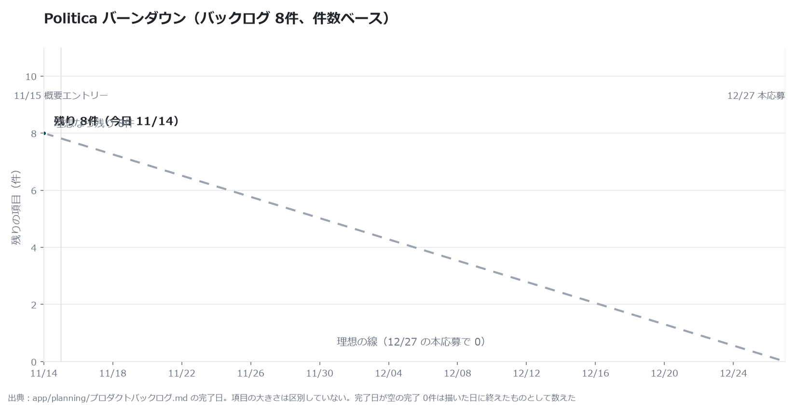

# プロダクトバックログ

> **管理**：やることと進み具合は、このファイルだけで管理する。
> **書き方**：自分の担当の行の「状態」「メモ」を直接直してください。終わったら「完了日」も入れる。バックログに無い作業をしていたら行を足す。

状態：未着手／進行中／完了／保留。優先度は MoSCoW：Must＝提出に必須／Should＝できればやる／Could＝余力があれば／Won't＝今回はやらない。

## バーンダウン

残りの件数の推移（完了日から描き直す。最終更新 11/14）。理想の線は 12/27（本応募の締切）に0になる形。完了日が空の「完了」は、描いた日に終えたものとして数える。

## 機能開発

| タイトル | 担当 | 状態 | 優先度 | 期限 | 完了日 | 関連 | メモ |
| --- | --- | --- | --- | --- | --- | --- | --- |
| 技術構成を決める（画面・バックエンド・使うデータ） |  | 未着手 | Must |  |  |  |  |

## UI

| タイトル | 担当 | 状態 | 優先度 | 期限 | 完了日 | 関連 | メモ |
| --- | --- | --- | --- | --- | --- | --- | --- |
| 画面のモック |  | 未着手 | Must |  |  |  |  |

## 分析・企画

| タイトル | 担当 | 状態 | 優先度 | 期限 | 完了日 | 関連 | メモ |
| --- | --- | --- | --- | --- | --- | --- | --- |
| 作品概要エントリーを出す（代表者・作品名・タイプ＝アプリケーション・テーマ＝教育・政治） |  | 未着手 | Must | 11/15 |  |  | 締切 11/15（日）23:59。フォーム：https://forms.gle/tTcc9dGwGGtA4NoAA |
| 既存の政治参加・主権者教育のサービスを調べる |  | 未着手 | Must |  |  |  | survey/kizon-service/ |
| 使えるオープンデータを洗い出す（投票率・議会・予算など） |  | 未着手 | Must |  |  |  | 利用規約も確かめる |
| ペルソナ・ユースケースを決める |  | 未着手 | Must |  |  |  | skills/product/persona-usecase/ |
| データキッズ賞などの副賞の対象になるか確かめる |  | 未着手 | Could |  |  |  | docs/contest.md |
| 作品本応募を出す |  | 未着手 | Must | 12/27 |  |  | 締切 12/27（日）23:59。案内は 11月末に代表者へ届く |

## 更新履歴

| 日付 | 内容 |
|---|---|
| 11/14 | 作った |
