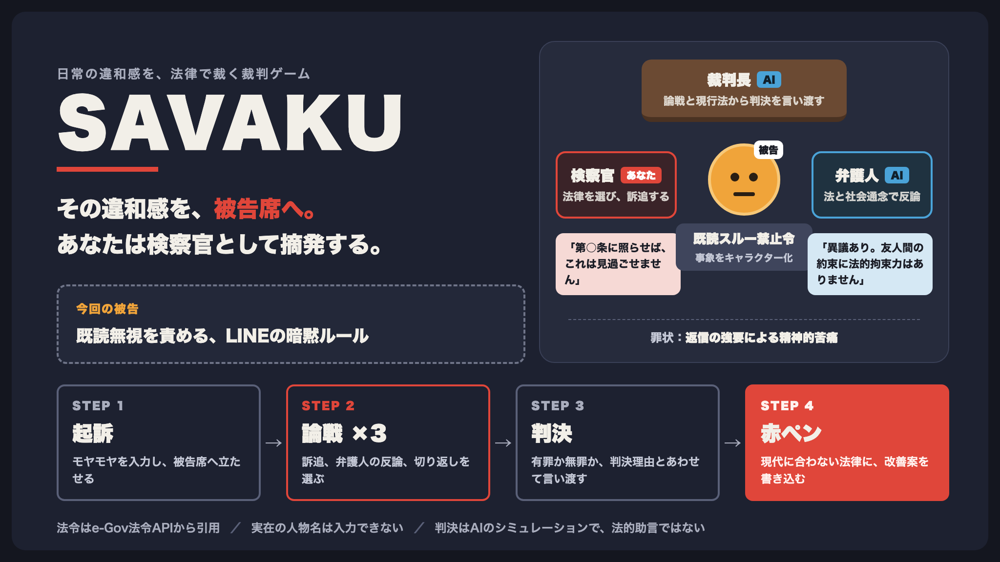

■k-masahiro116
(1)アイデア名：SAVAKU

    コンセプト：日常の不満や違和感、曖昧なことを法律で裁くことができる。SNSの扱い方、学校や職場、暮らしの中の関わり合い、不安定な世の中を法律を通して見る。気になった事象を被告に立たせ、自分は検察官の立場で摘発を試みる。弁護や裁判長はAIが代替し、裁判を通して法律や納得感のある落とし所を学べる。対象は、法律を身近に感じさせたい国民全体。

    解決する課題：
    ・日常の不満や違和感、曖昧な出来事が、法律とどう関係するのか分からない。
    ・SNS、学校や職場、暮らしのルールを、法律の言葉で考える場がない。
    ・法律が条文や専門家のもので終わり、自分の立場から法を問う体験がない。

    既存プロダクトの有無：

| # | 領域 | プロダクト | 提供者・形態 | 概要 | アイデアとの合致点 | 参照先 |
|---|---|---|---|---|---|---|
| 1 | AIによる裁判・法務の代替 | DoNotPay | DoNotPay／AIリーガルサービス | 「世界初のロボット弁護士」を掲げるAIサービス。駐車違反や不当な請求など、日常の不満やトラブルに対して、AIが法的な異議申し立てや手続きを代行する | 日常の不満を、法律の手続きで扱う | [donotpay.com](https://donotpay.com/) |
| 2 | AIによる裁判・法務の代替 | Character.ai | Character.AI／AIキャラクター対話 | AIキャラクターと対話・ロールプレイできるプラットフォーム。ユーザー作成の「AI裁判官」や「AI弁護士」と模擬裁判を行う遊び方が広がっている | 弁護や裁判長をAIが務める模擬裁判に近い | [character.ai](https://character.ai/) |
| 3 | 日常のモヤモヤを裁く | 弁護士ドットコム | 弁護士ドットコム株式会社／法律相談ポータル | 日常のトラブル、SNSでの誹謗中傷、学校・職場での問題などを、法律の視点から相談・閲覧できる日本のポータル | 日常の事象を法律に照らして見る | [bengo4.com](https://www.bengo4.com/) |
| 4 | 日常のモヤモヤを裁く | Reddit（r/AmItheAsshole） | Reddit／コミュニティ掲示板 | 日常生活の違和感や人間関係のモヤモヤを投稿し、第三者に「どちらが悪いか」を判定してもらう掲示板 | 曖昧な日常を、有罪・無罪のようにジャッジする | [r/AmItheAsshole](https://www.reddit.com/r/AmItheAsshole/) |
| 5 | ゲームや議論を通じて法律・正義を学ぶ | iCivics | iCivics（米国非営利団体）／市民・法教育ゲーム | 裁判や憲法をテーマにしたゲーム（Argument Wars など）を通じ、プレイヤーが法廷での議論や、正義・権利の仕組みを学べる | 法廷の議論を通じて正義と権利を学ぶ | [icivics.org](https://www.icivics.org/) |
| 6 | ゲームや議論を通じて法律・正義を学ぶ | 逆転裁判（・逆転検事） | カプコン／法廷バトルゲーム | 証拠をもとに矛盾を突き、真実と正義を追求する。スピンオフの『逆転検事』では、検察官の立場から事象を摘発する | 検察官として摘発し、法廷で正義を問う体験に近い | [ace-attorney.com](https://www.ace-attorney.com/ja/) |
| 7 | ゲームや議論を通じて法律・正義を学ぶ | Kialo（Kialo Edu） | Kialo／議論プラットフォーム | 正解のない社会問題や曖昧なテーマについて、賛否をツリー構造で整理・議論する。論理的思考や多角的な視点を養う教育ツールとしても使われる | 曖昧なテーマを、対立する主張から考える | [kialo.com](https://www.kialo.com/) |
| 8 | ゲームや議論を通じて法律・正義を学ぶ | LOST JUDGMENT：裁かれざる記憶 | セガ／リーガルサスペンスゲーム | 学校でのいじめやSNSの拡散、法で裁ききれない悪をテーマにする。現代社会の不安定さのなかで「法律と正義とは何か」を問いかける | 学校やSNSを、法律と正義の問いとして扱う | [judgment.sega.com](https://judgment.sega.com/) |
| 9 | ゲームや議論を通じて法律・正義を学ぶ | Papers, Please | Lucas Pope／シミュレーションゲーム | 入国審査官として、次々と現れる人々を法律・規則に照らして審査・摘発する。規則の厳格さと、個人の感情・正義のジレンマを体験できる | 規則に照らして摘発する側に立ち、正義とのずれを体験する | [papersplea.se](https://papersplea.se/) |
| 10 | ゲームや議論を通じて法律・正義を学ぶ | 裁判員制度ウェブサイト | 最高裁判所／公式の学習・広報サイト | 裁判の仕組みや評議の流れを学べる公式コンテンツ。模擬裁判のシナリオや学習教材が公開されており、市民の視点で裁判と法律を学ぶことができる | 裁判のプロセスを通じて法律を学ぶ | [saibanin.courts.go.jp](https://www.saibanin.courts.go.jp/) |

    ペルソナ：法律を身近に感じさせたい国民全体のうち、入り方の違う3タイプ。

| 項目 | ペルソナ①：SNSの空気に疲れる会社員 | ペルソナ②：ニュースを法の枠で読みたい関心層 | ペルソナ③：暮らしの「決まり」に納得できない人 |
| --- | --- | --- | --- |
| **基本属性** | **中村 彩（28歳・会社員）** 都市部のIT企業。一人暮らし | **木下 誠（41歳・メーカー勤務）** 地方都市。配偶者と小学生の子 | **林 恵（52歳・自営業）** 商店を営む。地域の行事にも顔を出す |
| **普段の関心・情報の入り方** | XやInstagramで情報収集。職場や友人関係の炎上、裏アカ、既読の空気をよく見る。 | ニュースアプリや解説動画で社会問題を追う。コメント欄は読むが、極端な二元論に疲れる。 | テレビ、地域のSNS、店先の会話。学校、行政、商慣習の「昔からの決まり」に触れることが多い。 |
| **日常のモヤモヤ・課題** | グループの同調圧力や、「どちらが悪いか」で終わる叩き合いに疲れている。自分の違和感がおかしいのか、法から見てどうなのか、基準がほしい。 | ニュースの議論が感情で割れて終わり、条文や判例に当たる前に結論が出る。法律に興味はあるが、専門書や相談のハードルが高い。 | 校則、職場の慣行、役所の説明が「決まりだから」で終わる。誰のどの権利の話なのかが分からず、納得できない。 |
| **SAVAKUで「被告」にしそうなテーマ** | ・既読無視を責めるLINEの暗黙ルール ・SNSの切り抜き動画による誹謗中傷 ・職場の理不尽なシフト強制 | ・ステマ疑惑のあるインフルエンサー ・生成AIによる著作権侵害 ・デマの拡散と、どこまでが表現か | ・理由の見えない校則やローカルルール ・消費者トラブルや景品表示 ・「連帯責任」で個人に押し付ける慣行 |
| **刺さるポイント（利用動機）** | 感情論ではなく、法律という物差しでモヤモヤを整理できる。AIが相手なので、周囲に気を使わず本音で起訴できる。 | 検察官として論点を組み立て、弁護人の反論を受ける知的なやりとり。社会の出来事を、構造と条文で理解できる。 | 弱い側の不満を、検察官として摘発できる。勉強ではなく、自分の暮らしの出来事から法律に触れられる。 |
| **主な利用シーン** | 通勤中や、夜にSNSを見てモヤッとした直後。 | ニュースを見て「これ、法的にはどうなのか」と思ったとき。 | 店や家庭で「決まりだから」と言われた夜に、その決まりを被告にする。 |

    3タイプに共通するのは、日常の違和感を言葉にしたいが感情的な争いにはしたくない、ルールや根拠で納得したい、という気持ち。法律が暮らしに触れ始めるあらゆる場面が入口になる。

    キャッチコピー：その違和感を、被告席へ。

    アプリ概要（30秒でいうと）：「SNSの炎上、職場や学校の空気、暮らしの中の“なんとなくモヤモヤすること”を法律で裁く、AI模擬裁判アプリです。利用者は気になった事象を被告に立たせ、自らが検察官となって摘発に挑みます。弁護や判決はAIが担当します。感情論ではなく法律という物差しで世の中を見ることで、日常の違和感を整理しながら、法律を自分の出来事として感じられます。対象は、法律を身近に感じさせたい国民全体です。」

    その他アプリ機能：裁判フロー、UX・学習・継続性、AI・安全性・非機能要件を整理した表。刑事裁判の形式に合わせ、弁護は被告側の弁護人としている。不足していた機能・非機能の補完を含む。別AIによる要件のたたき台であり、内容は要確認。

| 区分 | 項目 | 内容 |
|---|---|---|
| 1. コア機能（裁判フロー） | トップ・起訴入力画面 | 「被告について（裁きたい事象・モヤモヤ）」を自然言語で入力できるテキストエリアを置く。具体性を高めるため、文字数制限（例：20〜300文字）と入力例のプレースホルダーを用意する。「被告席へ」ボタンでAIの解析を開始し、開廷画面へ遷移する |
| 1. コア機能（裁判フロー） | 被告の具現化・開廷 | 入力された事象をAIがキャラクター化（または象徴的なオブジェクト・名称化）し、被告席に表示する。AI（裁判長または書記官）が、入力内容から整理した罪状（起訴事実）を読み上げる |
| 1. コア機能（裁判フロー） | 適用法律の選択（1ターン目） | 罪状に対し、適用できそうな実在の法律・条文の選択肢をAIが3つ提示する。ユーザー（検察官）が該当すると考える法律を1つ選ぶ |
| 1. コア機能（裁判フロー） | 訴追・反論の論戦（全3ターン） | 選んだ法律に基づき、AIが検察官の訴追文章を自動生成し、被告へ突きつける。被告側の弁護人（AI）が、法的観点や社会通念から反論を読み上げる。反論に応じた切り返し（さらなる訴追案）を3つの選択肢で提示し、ユーザーが選ぶ。この「訴追、弁護人の反論、選択」を計3ターン繰り返す |
| 1. コア機能（裁判フロー） | 判決 | 3ターンの論戦内容と現行法を踏まえ、裁判長（AI）が有罪・無罪（または量刑・主文）と判決理由を言い渡す |
| 1. コア機能（裁判フロー） | 振り返り・赤ペン（法改正） | 裁判で登場した法律・条文を一覧表示する。ユーザーが現代に合っていない、違和感があると感じた法律を選び、改善案を赤ペン（テキスト入力・添削UI）で書き込める |
| 2. 追加機能（UX・学習・継続性） | 入力サポート（お題・プリセット） | 初回利用で入力に迷わないよう、暮らし（残業代のないシフト、ステマ、解約しにくい定期購入）と学校（既読無視、ブラック校則）のサンプル被告を、ワンタップで試せるお題として用意する |
| 2. 追加機能（UX・学習・継続性） | 法律・条文の解説ポップアップ | 選択肢や論戦中の法律名をタップすると、専門用語をかみ砕いた解説と実際の条文を確認できる |
| 2. 追加機能（UX・学習・継続性） | 裁判ログ・マイ法典 | 過去の判決と、赤ペンで改正した法律を「マイ法典」として保存・閲覧できる |
| 2. 追加機能（UX・学習・継続性） | シェア機能 | 判決結果（被告名・罪状・判決）や赤ペン改正案を画像化し、SNSで共有できる |
| 2. 追加機能（UX・学習・継続性） | 途中離脱・やり直し | 裁判の途中で別の選択肢を試し直せるリトライ、または中断データの保持 |
| 3. AI・安全性・システム | 実在人物・誹謗中傷のガードレール | 入力に実在する個人名（知人、同僚、教師、有名人など）や、過度なヘイト・暴力的表現が含まれる場合、AIが検知してブロックするか、架空の事象へ抽象化する |
| 3. AI・安全性・システム | 法的免責の表示 | 「本アプリの判決はAIによるシミュレーションであり、実際の法的助言ではない」旨を、初回起動時と判決画面に表示する |
| 3. AI・安全性・システム | ハルシネーション対策 | 選択肢の法律は、用意した法令データベース（またはRAG）を参照し、実在しない条文をAIが作らないようにする |
| 3. AI・安全性・システム | AI生成待ち時間の演出 | テキスト生成や被告ビジュアル生成の数秒間に、「起訴状を作成中…」「弁護人が反論を準備中…」などの法廷演出（ローディングUI）を挟む |
| 3. AI・安全性・システム | 対応環境 | 国民が日常的に使うスマートフォン（iOS / Android、またはモバイル最適化したWebアプリ）をメインターゲットとする |
| 3. AI・安全性・システム | アカウント管理 | ゲスト利用（ログイン不要）ですぐに1回遊べるようにし、履歴保存やマイ法典を使うときにログインを求める |

    使うオープンデータ：法令の引用、判決の根拠、お題の補強に使える公式データ。

| # | 区分 | データ | 提供者 | 内容 | 使い方・条件 | 参照先 |
|---|---|---|---|---|---|---|
| 1 | 法令（コア） | e-Gov法令API（Version 2）／XML一括ダウンロード | デジタル庁 | 憲法・法律・政令・省令などの現行法令の全文、改正履歴、キーワード検索 | 無料・登録不要・APIキー不要。JSONでの取得とキーワード検索に対応する。政府標準利用規約（第2.0版）に準拠し、出典を明記すれば商用利用も可能 | [laws.e-gov.go.jp](https://laws.e-gov.go.jp/api/2/swagger-ui) |
| 2 | 判例 | 裁判例検索 | 最高裁判所 | 最高裁・高裁・地裁などの主要判例のテキスト・PDF | 公式APIはない。有罪・無罪が分かれた基準の参照元として使う | [courts.go.jp](https://www.courts.go.jp/app/hanrei_jp/search1) |
| 3 | 判例 | 日本の判例HTMLデータ | 国立情報学研究所（NII）／人工知能法学研究センター | 最高裁判所が公開する判例PDFをテキスト化したHTML。最高裁・高裁・下級裁などの判例集を含む | 学術研究目的に限る。申請と審査が必要で、営利目的は原則禁止。申請代表者は学生不可 | [nii.ac.jp](https://www.nii.ac.jp/dsc/idr/rdata/HANREI/) |
| 4 | 立法背景 | 国会会議録検索システム 検索用API | 国立国会図書館 | 国会での法案審議・議論の記録 | 無料・登録不要。法律が作られた理由や過去の反対意見を引き、弁護人の反論や赤ペン（法改正）のヒントにする | [kokkai.ndl.go.jp](https://kokkai.ndl.go.jp/api.html) |
| 5 | 日常のトラブル・お題 | e-Stat API | 総務省統計局（e-Stat） | 文部科学省のいじめ・不登校等の調査、警察庁のサイバー犯罪・SNS起因事犯の統計など | プリセットや判決に「同様のトラブルが年間何件か」を添えられる。API利用には利用者登録とアプリケーションIDが必要 | [e-stat.go.jp](https://www.e-stat.go.jp/api/) |

    プロトタイプでは、毎回すべての法令を検索せず、e-GovのXML一括ダウンロードから日常・学校・SNSに直結する主要法令（20〜30本）を抜き、RAGに格納する。

    ・SNS・ネット：刑法（名誉毀損・侮辱・脅迫）、情報流通プラットフォーム対処法（旧プロバイダ責任制限法）、著作権法、不正アクセス禁止法
    ・学校・日常：日本国憲法、民法（不法行為）、軽犯罪法、いじめ防止対策推進法、児童福祉法
    ・バイト・消費：労働基準法、特定商取引法、景品表示法（ステマ規制など）

    対象とする人：法律を身近に感じさせたい国民全体。

    その理由：法律は、選挙、裁判員、トラブルが起きたあとだけのものになりやすい。SNS、職場、学校、消費など、誰の日常にも違和感はある。その違和感を被告にし、検察官として摘発する体験は、年齢や立場を問わず、法律を自分の出来事として感じる入口になる。

    課題との紐づき：
    ・課題：日常の違和感と、法律がつながっていない。法律に対し問題意識を持てていない。
    ・紐付き：事象を被告に立て、検察官として摘発し、AIの弁護と裁判を経ることで、法律を自分の暮らしから感じられる。

    期待効果：
    ・曖昧な不満を、法律の論点として言語化できる。
    ・検察・弁護・裁判の役割の違いを、自分の事件を通して理解できる。
    ・暮らしの中の出来事を、法律の観点から見直すきっかけになる。

    画面イメージ（あれば）：
    ・コンセプト画像は concept.png を参照。
    ・プロトタイプは mock/index.html を参照。AIは未接続で、用意したお題ごとに台本で応答する。暮らしのお題は、残業代のないシフト、広告だと分からない投稿、解約しにくい定期購入。

