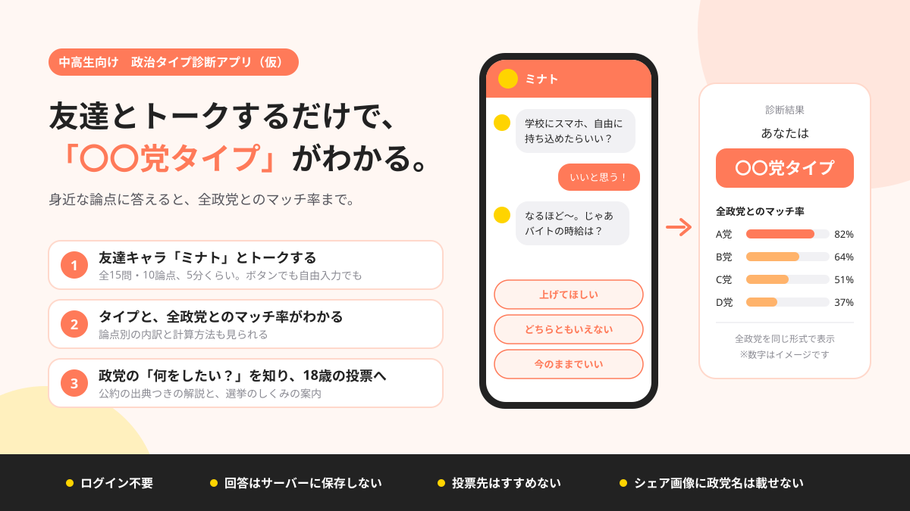
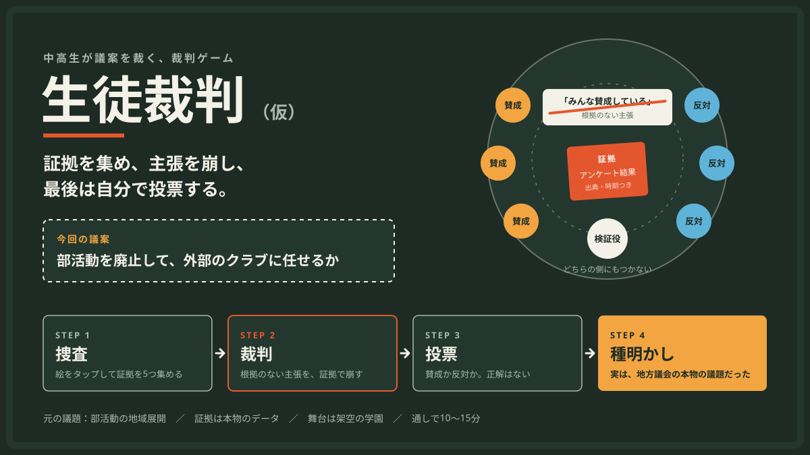
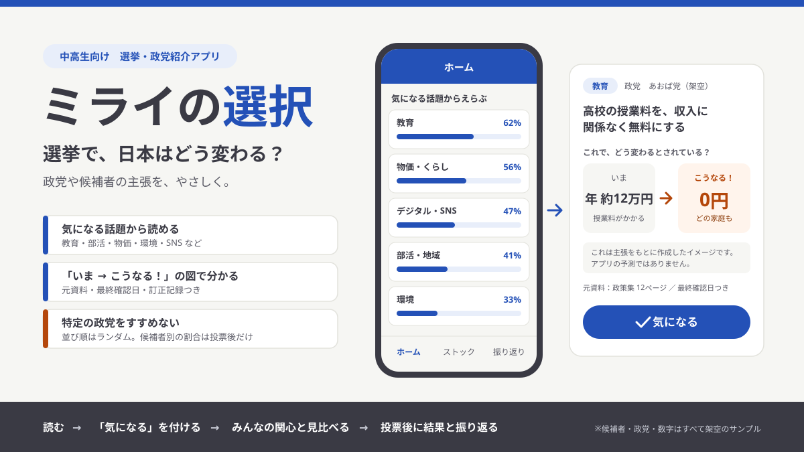
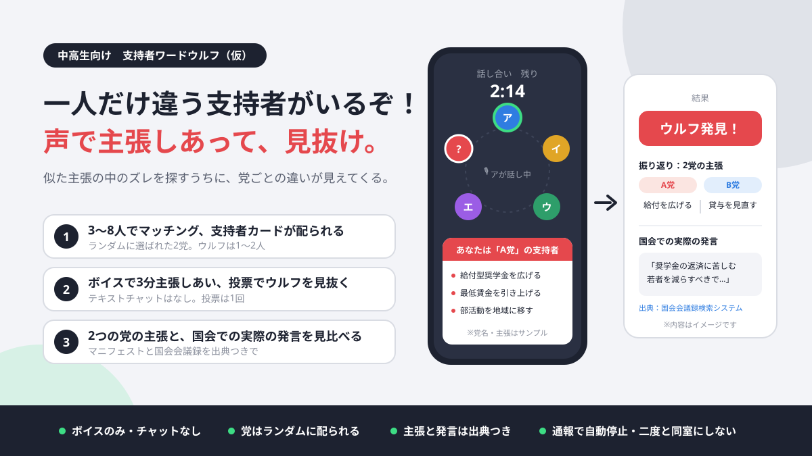
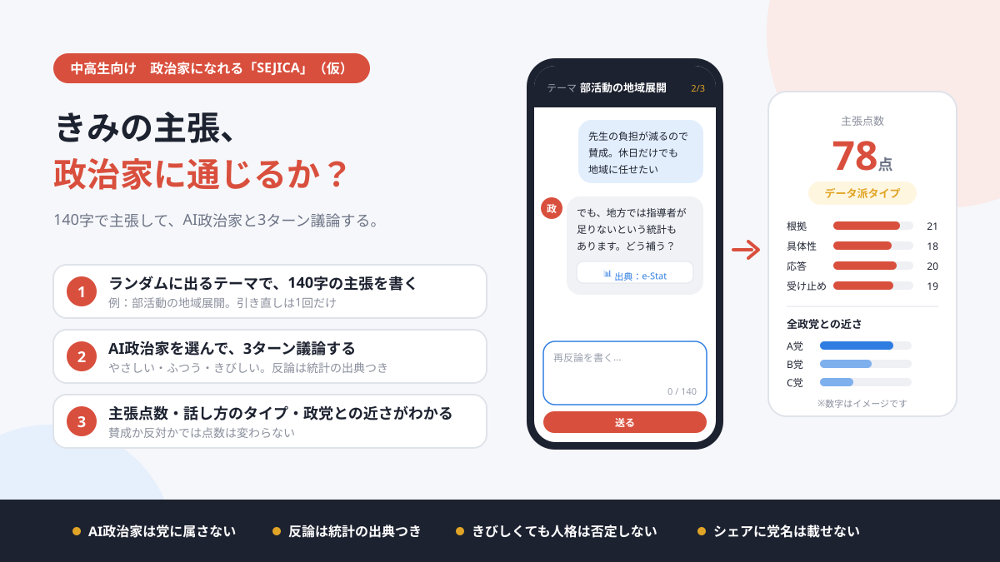

# idea/kentakodama99/ — kentakodama99のアイデア

アイデアをためておく場所。**1案＝1フォルダ**（`idea/kentakodama99/<アイデアの英字名>/README.md`）で置き、下の一覧に1行足す。
書き方は [`../template/README.md`](../template/README.md) の項目に沿う。

## 一覧

| アイデア | ひとことで | 状態 | モック |
|---|---|---|---|
| [政治タイプ診断アプリ（仮）](トウタイプ/README.md) | 友達キャラとのLINE風トークで「あなたは〇〇党タイプ」と全政党とのマッチ率がわかる | 仕様あり（[spec.md](トウタイプ/spec.md)） | [prototype-ui-app.html](トウタイプ/prototype-ui-app.html) |
| [議案を裁く裁判ゲーム「生徒裁判」（仮）](ダンガンロンパみたいなやつ/README.md) | 架空の学園の裁判で証拠を集めて根拠のない主張を崩し、投票したあとで実際の地方議会の議題（部活動の地域展開）だったと明かす | 仕様あり（[spec .md](ダンガンロンパみたいなやつ/spec%20.md)） | [PROTOTYPE-playable.html](ダンガンロンパみたいなやつ/PROTOTYPE-playable.html) |
| [中高生向け 選挙・政党紹介アプリ「ミライの選択」（仮）](政治紹介アプリ/README.md) | 気になる話題から政党・候補者の主張と「どう変わるとされているか」をやさしく読み、「気になる」でみんなの関心と見比べる | 仕様あり（[spec.md](政治紹介アプリ/spec.md)）・用語集・ADRあり | [mirai-no-sentaku-prototype.html](政治紹介アプリ/mirai-no-sentaku-prototype.html) |
| [支持者ワードウルフ（仮）](支持者ワードウルフ/README.md) | ランダムにマッチングした3〜8人が、配られた政党の支持者カードを手にボイスで主張しあい、一人だけ違う党の支持者を見抜く | 仕様あり（[spec.md](支持者ワードウルフ/spec.md)） | [mock/index.html](支持者ワードウルフ/mock/index.html)（3案） |
| [政治家になれる「SEJICA」（仮）](SEJICA/README.md) | ランダムに出るテーマで140字の主張をし、性格の違う AI政治家と3ターン議論して、主張点数・話し方のタイプ・全政党との近さを知る | 仕様あり（[spec.md](SEJICA/spec.md)） | [mock/index.html](SEJICA/mock/index.html)（3案） |

## コンセプト画像

### [政治タイプ診断アプリ（仮）](トウタイプ/README.md)

### [議案を裁く裁判ゲーム「生徒裁判」（仮）](ダンガンロンパみたいなやつ/README.md)

### [中高生向け 選挙・政党紹介アプリ「ミライの選択」（仮）](政治紹介アプリ/README.md)

### [支持者ワードウルフ（仮）](支持者ワードウルフ/README.md)

### [政治家になれる「SEJICA」（仮）](SEJICA/README.md)

