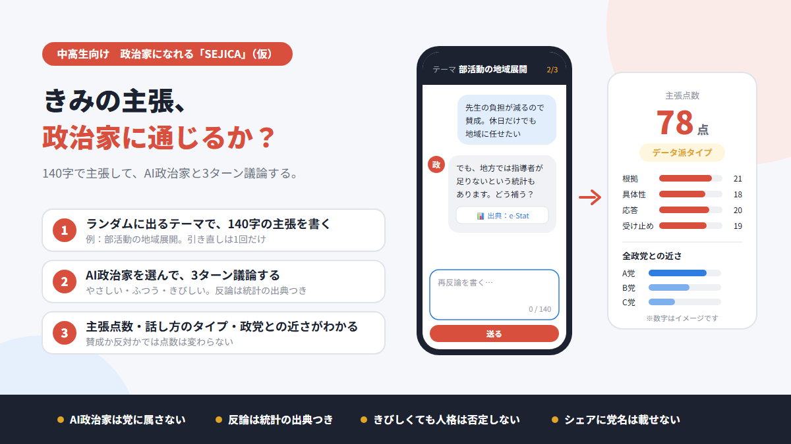

# 政治家になれる「SEJICA」（仮）

- 仕様：[`spec.md`](spec.md)
- モック：[`mock/index.html`](mock/index.html)（構造の違う3案。`?variant=A|B|C` と `?phase=` で切り替える）
- コンセプト画像：[`concept.png`](concept.png)（元データは [`concept.svg`](concept.svg)）

---

## ■kentakodama99

### (1) アイデア名

政治家になれる「SEJICA」（仮）— 用意されたテーマで自由に主張し、AI政治家と3ターン議論する。主張点数と、向いている党のタイプがわかる

### 解決する課題

中高生は、政治の話題について自分の意見を言葉にし、反対の意見を受け止めた経験がない。意見を言う場も、反論してくれる相手もないまま18歳を迎えている

### 既存プロダクトの有無

投票マッチング（ボートマッチ）は、選択式の設問で近い党を出す。ディベートの授業や AI の会話サービスもある。ただし、政治のテーマで AI の政治家と議論し、話し方の点数と党との近さを出典付きで返すサービスは見当たらない。具体的なサービス名と違いは要調査（survey/README.md にためる）

### ペルソナ

自分の意見を言葉にしたことがなく、反対の意見を言われると黙ってしまう中高生へ

### キャッチコピー

きみの主張、政治家に通じるか？

### アプリ概要（30秒でいうと）

ランダムに出るテーマ（例：部活動の地域展開）について、140字で主張する。性格の違う3人の AI政治家から相手を選ぶと、統計を出典付きで示しながら反論してくる。3ターンのやり取りのあと、主張点数（100点）・話し方のタイプ・全政党との近さを知ることが可能

### その他アプリ機能

- テーマのランダム出題（チームが選んだ8〜10テーマから。1回だけ引き直し可）
- 対戦相手の選択（やさしい・ふつう・きびしいの3人。言い方と難易度が違い、点数の倍率が変わる）
- 3ターンの議論（主張 → 反論 → 再反論 → 反論 → 再反論 → しめの言葉）
- 反論の出典表示（e-Stat・白書の統計へのリンク）
- 主張点数（根拠・具体性・応答・受け止めを25点ずつ。賛成か反対かでは点が変わらない）
- 党のタイプ（やり取りの全体から AI が分析。全政党との近さを並べる。3テーマ以上で「向いている党のタイプ」）
- 傾向分析（考えの傾向を2本の軸の図に、話し方のタイプをデータ派・共感派などで）
- 結果のシェア（点数・話し方のタイプ・キャラクター名だけ。党の名前は出さない）

### 使うオープンデータ

- [e-Stat](https://www.e-stat.go.jp/) の統計、各省庁の白書（AI政治家の反論の根拠）
- 第51回衆議院議員総選挙（2026年2月8日）の各党のマニフェスト。チームで「党 × テーマ × 立場（5段階）× 出典」の構造化データにして、CC BY で公開する（党のタイプの分析に使う。ほかの案と共通）
- 利用規約の確認は要調査

### 未成年向けだから成立する理由

支持する党がまだない中高生だからこそ、党の看板なしに、自分の考えから出発して議論できる。大人向けのボートマッチは「どの党に入れるか」を決める道具だが、SEJICA は投票の前に「意見を言葉にして、反論を受け止める」練習の場になる

### 課題との紐づき

- 「意見を言葉にしたことがない」に対して、140字で主張するテーマ出題で解決できる
- 「反対の意見を受け止めた経験がない」に対して、AI政治家の反論と「受け止め」の採点で解決できる
- 「相手が怖くて話せない」に対して、やさしいキャラクターから始められる対戦相手の選択で解決できる
- 「自分の考えと政党が結びつかない」に対して、全政党との近さと考えの傾向の図で解決できる

### 期待効果

中高生が、政治のテーマで自分の意見を言い、反論に答える経験を積む。そのうえで、自分の考えと政党との近さを知る。コスト削減の金額は未定

### 画面イメージ（あれば）

[mock/index.html](mock/index.html)（3案を比較中）
