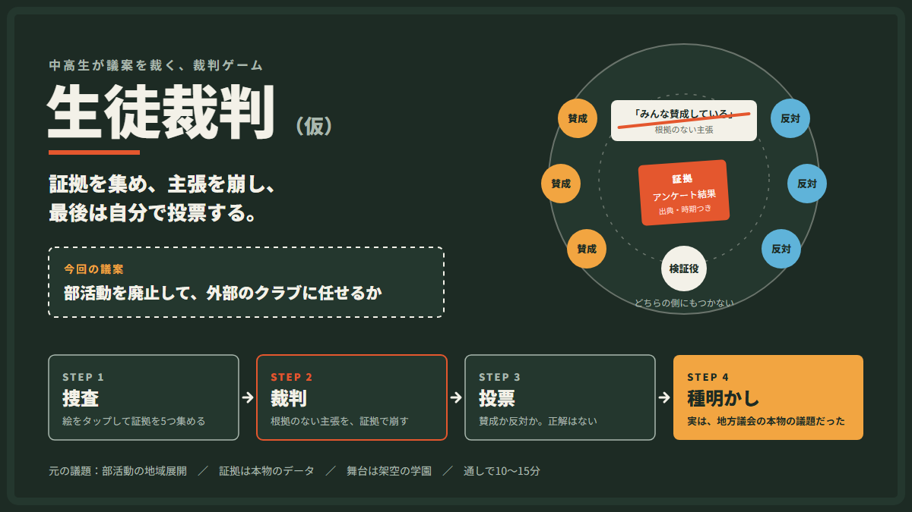

# 議案を裁く裁判ゲーム「生徒裁判」（仮）

- 仕様：[`spec .md`](spec%20.md)
- 用語集：[`GLOSSARY.md`](GLOSSARY.md)
- 設計判断：[`0001-no-ai-rebuttal.md`](0001-no-ai-rebuttal.md)（AIによる反論は入れない）、[`0002-real-agenda-fictional-school.md`](0002-real-agenda-fictional-school.md)（実際の地方議会の議題を架空の学園に置き換える）
- モック：[`PROTOTYPE-playable.html`](PROTOTYPE-playable.html)（遊べる試作。1ファイル構成）
- コンセプト画像：[`concept.png`](concept.png)（元データは [`concept.svg`](concept.svg)）

---

## ■kentakodama99

### (1) アイデア名

議案を裁く裁判ゲーム「生徒裁判」（仮）— 捜査で証拠を集め、裁判で根拠のない主張を崩し、最後に自分で投票する

### 解決する課題

投票権を持つ前の中高生にとって、政治は「大人の世界の遠い話」で、自分の生活と結びついていない。地方議会では部活動のように中高生の毎日に直結する議題が話し合われているのに、それを知る機会も、賛成・反対それぞれの根拠を比べて自分で判断する経験もない。授業の主権者教育は教材っぽさが強く、自分から関心を持つきっかけになりにくい

### 既存プロダクトの有無

主権者教育の教材や模擬選挙・模擬議会の取り組みはあるが、「捜査して、裁判で矛盾を崩す」ゲームの形で、実際の地方議会の議題を扱うものは見当たらない。具体的なサービス名と違いは要調査（survey/README.md にためる）

### ペルソナ

政治は大人の遠い話で、自分の生活とは関係ないと思っている中高生へ

### キャッチコピー

（未定）

### アプリ概要（30秒でいうと）

架空の学園の「生徒による裁判」で、検証役として証拠を集め、賛成側・反対側の根拠のない主張を崩したうえで自分で投票し、最後にそれが実際の地方議会の議題（部活動の地域展開）だったと知ることが可能

### その他アプリ機能

- 捜査（2Dの一枚絵をタップして証拠を集める。証拠ごとに出典を表示。ひっかけの証拠も混ぜる）
- 論者の話を聞く（賛成3人・反対3人の立場と言い分を事前に知る）
- 裁判（3Dの裁判場。流れてくる主張から根拠のない主張を見つけ、証拠を突きつけて崩す。賛成側・反対側2つずつ）
- 崩したあとの解説（データの読み違い、一部を全体のように言う、など主張のどこがおかしかったか）
- 間違えたときのやり直しと段階的なヒント（反射神経ではなく、考えれば解ける形）
- 投票（賛成・反対を自分で選ぶ。正解・不正解はない）
- みんなの投票結果（匿名で集計。通信できなくてもエンディングまで進める）
- 元の議題の種明かし（国のガイドライン・議会資料へのリンク、自分の市の議事録の調べ方と傍聴の方法）
- デモ用に途中の場面から始める機能、シナリオをコードを書かずに編集・検証する仕組み

### 使うオープンデータ

部活動の地域展開に関する国のガイドライン・調査データ、地方議会の議事録・議会資料。証拠に使う本物のデータには出典（資料名・発行元・時期）を必ず記録する。具体的なURLと利用規約は要調査

### 未成年向けだから成立する理由

投票権を持つ前の中高生には「誰に投票するか」より先に、根拠を比べて自分で判断する経験が要る。議題に選んだ部活動の地域展開は、大人より中高生の生活に直結する。ゲームの形なら授業っぽさなく自分から触れられる。舞台を架空の学園にし、現実の政党名・議員名を出さないことで、学校で使うときの政治的中立にも配慮している

### 課題との紐づき

- 「政治は遠い話」に対して、架空の学園の裁判というゲームの形と、最後の元の議題の種明かしで、現実の議会とのつながりに気づかせて解決できる
- 「自分の生活と結びつかない」に対して、部活動という中高生の毎日に直結する議題を扱うことで解決できる
- 「根拠を比べて判断する経験がない」に対して、検証役として両方の側の根拠のない主張を証拠で崩し、残った筋の通った主張をもとに自分で投票する流れで解決できる
- 「自分から関心を持つきっかけがない」に対して、自分の市の議事録の調べ方・傍聴の方法の案内で、ゲームの外での最初の一歩につなげて解決できる

### 期待効果

中高生が、身近な議題が地方議会で話し合われていることを知り、データの根拠を確かめて自分で判断する力をつける。18歳での投票や地方議会への関心につながる。コスト削減の金額は未定

### 画面イメージ（あれば）

[PROTOTYPE-playable.html](PROTOTYPE-playable.html)

---

## 補足（spec .md より）

- **中立性**：検証役はどちらの側にもつかず、賛成側・反対側の根拠のない主張を2つずつ崩す。崩したあとも両方の側に筋の通った主張を残し、投票で本当に迷えるようにする
- **AIを使わない**：裁判の流れはすべてシナリオデータで決める。未成年向けの不適切発言対策と、3分のデモでの事故を避けるため（ADR 0001）
- **プライバシー**：ログインなし。投票は匿名で、個人を特定できる情報は受け取らない
- **推奨構成**：TypeScript、React と React Three Fiber（3Dは裁判場だけ）、匿名の投票集計API。ゲーム進行ロジックは描画から切り離す
- **ボリューム**：1章分（議題は部活動の地域展開のみ）。通しで10〜15分、ハッカソンでは3分のデモ
