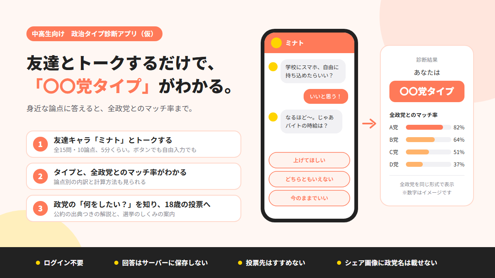

# 政治タイプ診断アプリ（仮）

- 仕様：[`spec.md`](spec.md)
- モック：[`prototype-ui-app.html`](prototype-ui-app.html)（スマホUIのプロトタイプ。1ファイル構成）
- コンセプト画像：[`concept.png`](concept.png)（元データは [`concept.svg`](concept.svg)）

---

## ■kentakodama99

### (1) アイデア名

政治タイプ診断アプリ（仮）— 友達キャラ「ミナト」とのトークで「あなたは〇〇党タイプ」がわかる

### 解決する課題

未成年（主に中高生）が政治を「難しい」「自分には関係ない」と感じていて、各政党が何をしようとしているのかを知るきっかけがない。そのまま18歳になり、関心もリテラシーも育たず投票に行かない層が生まれている

### 既存プロダクトの有無

選挙前に大人が使う投票マッチング（ボートマッチ）サービスはある。ただし設問も結果も硬く、未成年が気軽に触れる入口にはなっていない。具体的なサービス名と違いは要調査（survey/README.md にためる）

### ペルソナ

政治の話は難しくて自分には関係ないと思っている中高生へ

### キャッチコピー

（未定）

### アプリ概要（30秒でいうと）

LINE風のトーク画面で同い年の友達キャラと会話しながら身近な論点に答えるだけで、自分が「〇〇党タイプ」かと、全政党とのマッチ率を知ることが可能

### その他アプリ機能

- LINE風トーク画面での診断（全15問・10論点、5分程度）。返信はボタンでも自由入力でもよい
- 自由入力の解釈（AIが賛成〜反対の5段階に変換。解釈一覧を見て修正・再計算できる）
- 結果画面（〇〇党タイプ、全政党のマッチ率、論点別の内訳、計算方法、データ基準日）
- 政党解説（全政党同じ形式で「何をしたい？」「何が変わる？」、公約の出典リンク、公式YouTube動画）
- 結果後のAI対話（「〇〇党が勝ったら私の生活はどう変わる？」に、事前データだけを材料に出典つきで答える。投票先は勧めない）
- 投票への橋渡し（何歳で投票できるか、次の国政選挙、選挙の仕組みミニ解説）
- シェア画像（論点ごとの自分のスタンスだけ。政党名・マッチ率は載せない）

### 使うオープンデータ

各政党の公約（2026年2月衆院選）、各政党の公式YouTube動画、国政選挙の日程。どのデータをどこから取るか（URL）と利用規約は要調査

### 未成年向けだから成立する理由

投票権を持つ前の中高生には「誰に投票するか」を決める必要がなく、まず政党ごとの違いを楽しく知る入口が要る。MBTIのような「タイプ診断」と友達とのトークの形は、大人向けの硬い投票マッチングより未成年に合う。シェア画像に政党名を載せない設計で、18歳未満の選挙運動を禁じる公職選挙法にも配慮している

### 課題との紐づき

- 「政治が難しい」に対して、友達キャラとのタメ口トークと論点ごとの短い説明で解決できる
- 「自分には関係ない」に対して、教育・バイト・SNSなど身近な論点と「何が変わる？」の解説・AI対話で解決できる
- 「政党の違いを知るきっかけがない」に対して、全政党のマッチ率と論点別の内訳で解決できる
- 「18歳になっても投票に行かない」に対して、投票できる年齢・次の選挙の案内で解決できる

### 期待効果

未成年が政党ごとの違いと政策の自分への影響を知り、18歳での投票につながる。コスト削減の金額は未定

### 画面イメージ（あれば）

[prototype-ui-app.html](prototype-ui-app.html)

---

## 補足（spec.md より）

- **中立性**：全政党を同じ形式・同じ量で扱う。解説はAIで下書きし、人がチェックしてから載せる。その場で生成するのは結果後のAI対話だけ
- **プライバシー**：ログインなし。回答はサーバーに保存しない（政治的な考えは要配慮個人情報にあたるため）
- **推奨構成**：Next.js（Vercel）、自由回答の解釈は TypeSafe Jev（日本語精度が足りなければLLM）、AI対話はLLM、データはリポジトリ内のJSON
