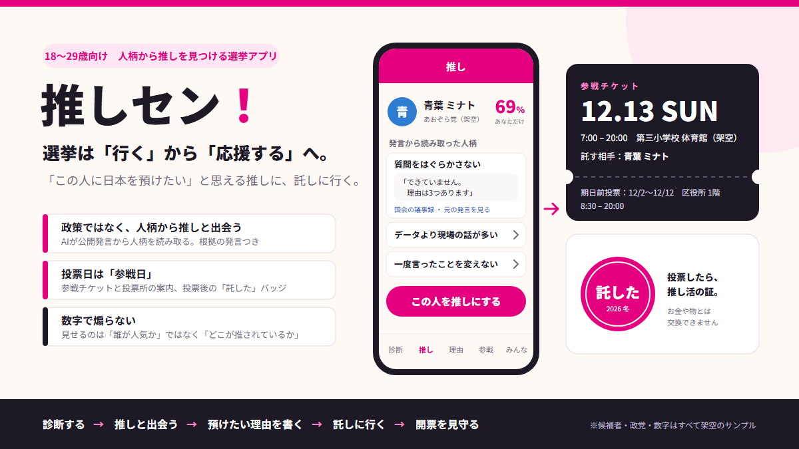

# 推しセン！

- 仕様：[`spec.md`](spec.md)
- 場合分けの整理：[`場合分け.md`](場合分け.md)（フェーズ × 年齢で何ができて何が見えるか。未決のことの一覧つき）
- モック：[`PROTOTYPE-oshisen.html`](PROTOTYPE-oshisen.html)（スマホUIのプロトタイプ。1ファイル構成。フェーズと年齢を切り替えて確かめられる。候補者・政党・数字はすべて架空のサンプル）
- コンセプト画像：[`concept.png`](concept.png)（元データは [`concept.svg`](concept.svg)）
- コンセプト動画：[`concept-video.mp4`](concept-video.mp4)（約54秒。アイドルが宣伝する形のアニメ。音声は VOICEVOX:春日部つむぎ、BGM は自作。キャラクター・候補者・政党・数字はすべて架空。作り方は [`video/build.mjs`](video/build.mjs)）

---

## ■kentakodama99

### (1) アイデア名

推しセン！ — 選挙は「行く」時代から「応援する」時代へ

### 解決する課題

若者の多くは選挙に行かない。理由としてよく言われるのは「自分が1票入れても変わらない」。ところが同じ若者が、1票の影響がもっと小さい人気投票には熱心に参加する。そこでは結果を変えるためではなく、人柄を見て応援したいから票を入れている。選挙に足りないのはこの「応援したい」という気持ちで、若者から見ると候補者は政策や数字の羅列でしかなく、人柄が見えない

### 既存プロダクトの有無

選挙情報サイトや投票マッチング（ボートマッチ）サービスはあるが、主に政策の一致度を見せるもので、候補者の人柄から「応援したい相手」を見つけ、投票日までを推し活として体験させる形にはなっていない。得票数や政策の一覧を表示するだけのサービスは気持ちが動かず、1票の格差や人気ランキングを見せるものは、かえって「行っても意味がない」という感覚を強める。具体的なサービス名と違いは要調査（survey/README.md にためる）

### ペルソナ

「自分が1票入れても変わらない」と思って選挙に行かない18〜29歳へ。18歳未満も、有権者になる前から診断と推し探しができる

### キャッチコピー

選挙は「行く」時代から「応援する」時代へ。

### アプリ概要（30秒でいうと）

「どんな人に日本を預けたいか」の診断に答えると、AIが公開発言から読み取った人柄をもとに相性のいい候補者が見つかり、その人を推しにして預けたい理由を言葉にし、投票日に「推しに託しに行く」ことが可能

### その他アプリ機能

- 人柄の好み診断（政治の知識がなくても答えられる二択。結果は「預けたい人物像」として出る）
- 候補者の人柄プロファイル（国会の議事録・演説・SNSから読み取った特徴。特徴ごとに元の発言を確認できる。根拠のない特徴は出さない）
- 相性（%）の表示（本人にだけ見える）
- 新人候補者の「情報少なめ」表示（情報が少ないことと人柄が薄いことを取り違えないようにする）
- 推しの登録・変更・解除と、箱推し（推しの所属政党と、同じ政党の他の候補者。比例代表の投票先を考える入口）
- 推しポイントタグと「預けたい理由」（誠実さ・行動力・聞く力などのタグに一言を添える）
- 推されている理由の内訳（候補者ごとの人数ではなく、どこが推されているかだけを見せる）
- 選挙区の傾向（重視されている推しポイント、若者の声がどれくらい届いているか）
- 推し仲間の声（同じ推しを持つ人の理由を読む。票の呼びかけや他の候補者への言及はAIが止める）
- 参戦チケットと投票ガイド（投票所・期日前投票の案内、リマインド）
- 「託した」バッジ（投票後に受け取る。お金や物とは交換できない）
- 開票見守りと振り返り（候補者ごとの応援の割合は開票後にだけ出す）
- 選挙がない時期の推しの更新（新しい発言から人柄の変化を知らせる）
- 時期による切り替え（平常時／公示前／選挙期間／投票日当日／開票後で、投稿できる内容と見せる指標を変える）

### 使うオープンデータ

- 国会の議事録（国立国会図書館の国会会議録検索システム）：人柄の特徴と根拠の発言に使う
- 候補者の選挙公報・公約、選挙の日程と結果（選挙管理委員会・総務省などの公開情報）：新人候補者の人柄、投票ガイド、開票結果に使う
- 年代別の有権者数と投票者数（総務省などの公開統計）：「若者の声がどれくらい届いているか」に使う
- 投票所・期日前投票所の場所と時間（各自治体の公開情報）：投票ガイドに使う

どのデータをどこから取るか（URL）と利用規約は要調査。演説動画やSNSはオープンデータではないので、扱い方は別に確かめる

### 未成年向けだから成立する理由

このアプリのメインユーザーは18〜29歳で、未成年だけに向けたものではない。未成年については、18歳未満でも診断と推しの閲覧ができるので、有権者になる前から「預けたい人」を持った状態で18歳の最初の選挙を迎えられる。18歳未満は選挙運動ができないため、投稿とシェアはどの時期もできないようにして、知らないうちに違反しないしくみを最初から組み込んでいる

### 課題との紐づき

- 「自分が1票入れても変わらない」に対して、結果を変えるためではなく推しに託すために行く、という参戦チケットと「託した」バッジの体験で解決できる
- 「候補者の人柄が見えない」に対して、公開発言から読み取った人柄プロファイルと根拠の発言で解決できる
- 「誰を選べばいいか分からない」に対して、人柄の好み診断と相性の表示で解決できる
- 「数字を見ると行く気がなくなる」に対して、人気や1票の重さは出さず、どこが推されているかと若者の声の届き方だけを見せることで解決できる
- 「選挙のときしか関心が続かない」に対して、選挙がない時期の推しの更新と推し仲間の声で解決できる

### 期待効果

18〜29歳が「応援したい相手」を持って投票に行くようになり、若者の投票率が上がる。18歳未満のうちから推しを見つけた人は、最初の選挙から投票につながる。コスト削減の金額は未定

### 画面イメージ（あれば）

[PROTOTYPE-oshisen.html](PROTOTYPE-oshisen.html)

---

## 補足（仕様・場合分けより）

- **公職選挙法への配慮**：候補者ごと・政党ごとの応援の割合は開票後にだけ出し、応援数・ランキング・当選予想はどの時期も出さない（人気投票の公表の禁止、第138条の3）。票の呼びかけは選挙期間にだけ書けるようにし、投票日当日は閲覧だけにする（第129条）。18歳未満は投稿もシェアもできない（第137条の2）。法解釈は未確認で、リリース前に選挙法に詳しい弁護士の確認が必要
- **中立性**：政党・候補者から広告やお金を受け取らない。人柄の特徴には必ず根拠の発言をつけ、候補者からの異議申し立てを受け付ける
- **AIの使い方**：人柄の読み取りと投稿チェックに使う。判定が特定の政党・候補者に偏っていないかを定期的に確かめるしくみは別途検討
- **未決のこと**：18歳未満が推し仲間の理由を読めるか、情報少なめの候補者の相性をどう計算するか、など8件。[`場合分け.md`](場合分け.md) の「未決のこと」にまとめている
