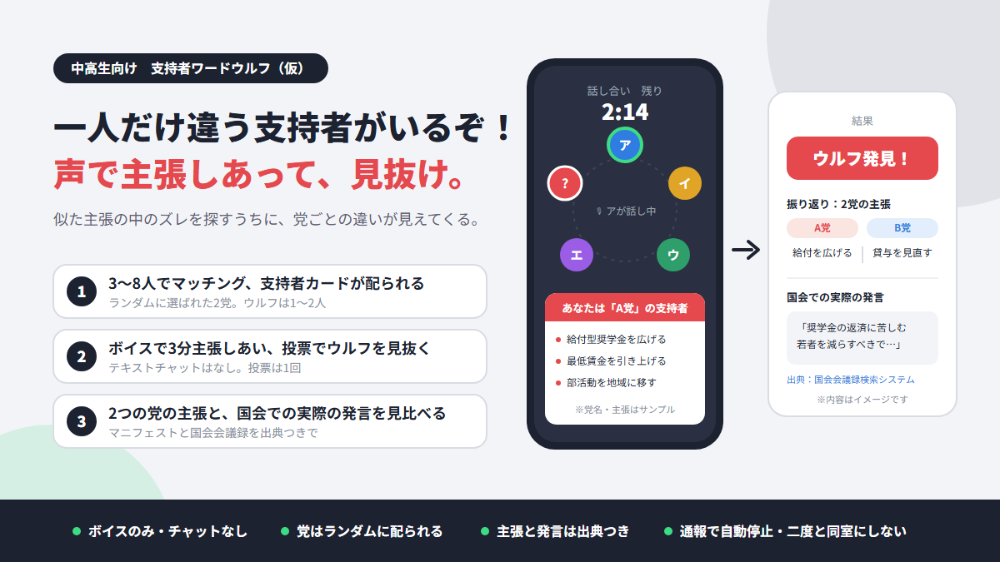

# 支持者ワードウルフ（仮）

- 仕様：[`spec.md`](spec.md)
- モック：[`mock/index.html`](mock/index.html)（画面案の使い捨てプロトタイプ。A 円卓／B 通話／C カードゲームの3案を、下のバーか `?variant=A|B|C` で切り替える。政党・主張・発言はすべて架空のサンプル）
- コンセプト画像：[`concept.png`](concept.png)（元データは [`concept.svg`](concept.svg)）

---

## ■kentakodama99

### (1) アイデア名

支持者ワードウルフ（仮）— 一人だけ違う党の支持者がまぎれている。声で主張しあって見抜く、オンライン対戦ゲーム

### 解決する課題

投票権を持つ前の中高生は、政党ごとの主張の違いを知らない。違いを知らないので、政治の話題を友達と話すこともない。マニフェストは読まれず、「どの党も同じことを言っている」と感じたまま18歳を迎えている

### 既存プロダクトの有無

ワードウルフそのものは、パーティーゲームとして広く遊ばれている。投票マッチング（ボートマッチ）や主権者教育の教材もある。ただし、政党の主張をお題にして、声で主張しあい違いを見抜くゲームは見当たらない。具体的なサービス名と違いは要調査（survey/README.md にためる）

### ペルソナ

政党の違いが分からず、政治の話をしたことがない中高生へ

### キャッチコピー

一人だけ違う支持者がいるぞ！見抜け！

### アプリ概要（30秒でいうと）

ランダムにマッチングした3〜8人が、それぞれ配られた政党の「支持者カード」を見ながらボイスで3分主張しあい、一人だけ違う党の支持者を投票で見抜くことが可能。終わったあとは、2つの党の主張と、実際の国会での発言を出典付きで見比べられる

### その他アプリ機能

- ログイン（LINE ログイン。13歳以上・自己申告。16歳未満は保護者の同意にチェック）
- ランダムマッチング（3〜8人。60秒待っても集まらなければ「集まりませんでした」と通知して戻る）
- お題の配布（第51回衆院選で議席を得た党から、システムがランダムに2党を選ぶ。3〜5人ならウルフ1人、6〜8人なら2人）
- 支持者カード（自分の党の主な主張3〜4個。党名付き）
- ボイスでの話し合い（3分。ボイスのみで、テキストチャットはない）
- 投票（1回。同数ならウルフの勝ち）
- 振り返り（2つの党の主張と、国会会議録から選んだ実際の発言を、出典付きで並べる）
- 通報（一定回数の通報で参加を自動停止。通報しあった人どうしは二度と同じ部屋にしない）
- デモモード（録音済みのプレイヤーと一人で1ゲームを体験できる。審査員向け）

### 使うオープンデータ

- 第51回衆議院議員総選挙（2026年2月8日）の各党のマニフェスト。チームで「党 × 主張 × 出典URL」の構造化データにして、CC BY で公開する
- [国会会議録検索システム](https://kokkai.ndl.go.jp/) の API（振り返り画面に、その党の議員の実際の発言を載せる）
- 利用規約の確認は要調査

### 未成年向けだから成立する理由

選挙権を持つ大人は「自分の支持する党」があり、他の党の支持者を演じるのに抵抗がある。まだ支持する党を持たない中高生だからこそ、ランダムに配られた党の支持者を役として演じ、党どうしの違いを遊びの中で体験できる

### 課題との紐づき

- 「政党ごとの違いを知らない」に対して、似た主張の中からズレを探すワードウルフの仕組みで解決できる
- 「マニフェストを読まない」に対して、主張を3〜4個にしぼった支持者カードで解決できる
- 「政治の話をしたことがない」に対して、ボイスで主張しあう話し合いで解決できる
- 「公約と実際の行動が結びつかない」に対して、振り返り画面での国会の発言との見比べで解決できる

### 期待効果

中高生が、ゲームを通して政党ごとの主張の違いと、実際の国会での発言に触れる。コスト削減の金額は未定

### 画面イメージ（あれば）

[mock/index.html](mock/index.html)（3案を比較中）
