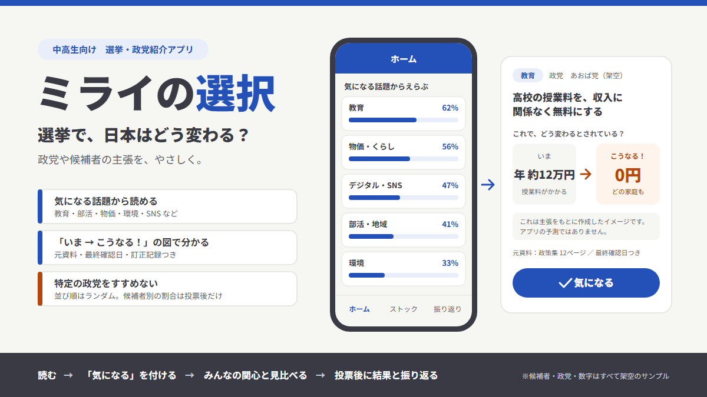

# 中高生向け 選挙・政党紹介アプリ「ミライの選択」（仮）

- 仕様：[`spec.md`](spec.md)
- 用語集：[`GLOSSARY.md`](GLOSSARY.md)
- 設計判断：[`0001-気になる割合は選挙期間中トピック単位のみ公開.md`](0001-気になる割合は選挙期間中トピック単位のみ公開.md)、[`0002-AIの文章は必ず人がチェックしチャットは付けない.md`](0002-AIの文章は必ず人がチェックしチャットは付けない.md)
- モック：[`mirai-no-sentaku-prototype.html`](mirai-no-sentaku-prototype.html)（スマホUIのプロトタイプ。1ファイル構成。候補者・政党・数字はすべて架空のサンプル）
- コンセプト画像：[`concept.png`](concept.png)（元データは [`concept.svg`](concept.svg)）

---

## ■kentakodama99

### (1) アイデア名

中高生向け 選挙・政党紹介アプリ「ミライの選択」（仮）— 選挙で、日本はどう変わる？ 政党や候補者の主張を、やさしく

### 解決する課題

投票権を持つ前の中高生が、選挙に出ている候補者・政党が何を主張していて、それで日本や自分の生活がどう変わるとされているのかを知る手段がない。公約やマニフェストは文章が硬く、ことばも難しい。選挙を「自分ごと」として見ないまま18歳を迎え、投票に行かない層が生まれている

### 既存プロダクトの有無

選挙情報サイトや投票マッチング（ボートマッチ）サービスはあるが、主に選挙権を持つ大人向けで、中高生が政策トピックから入り、主張ごとに「どう変わるとされているか」をやさしく読める形にはなっていない。具体的なサービス名と違いは要調査（survey/README.md にためる）

### ペルソナ

選挙が始まっても、だれが何を言っているのか、自分にどう関係するのかが分からない中高生へ

### キャッチコピー

選挙で、日本はどう変わる？（仮）

### アプリ概要（30秒でいうと）

教育・部活・物価・環境・SNSなど気になる話題から、政党や候補者の主張と、それで生活がどう変わるとされているかのイメージ解説を読み、「気になる」を付けて、みんなが何を気にしているかと見比べることが可能

### その他アプリ機能

- 話題（政策トピック）から選ぶホーム。話題ごとに、利用者のうち「気になる」を付けた人の割合を母数つきで表示
- 主張の一覧（候補者・政党の主張。特定の政党をすすめないよう、並び順は開くたびにランダム）
- 主張のくわしい説明（「いま → こうなる！」のイメージ図とイメージ解説、関係する人、元資料・最終確認日・訂正記録）
- ことばの説明（財源、無償化など、タップすると説明が出る）
- 前回の選挙での主張とくらべる（過去の主張を消さずに残す）
- 「気になる」とストック（気になった主張の一覧。この端末にだけ保存）
- みんなのコメント（話題ごとの匿名コメント。その話題の主張に「気になる」を付けた人だけ書ける。投票の呼びかけ・個人情報・人を傷つける表現はAIが見つけ、人が確認してから公開。通報もできる）
- 振り返り（投票締め切り後に、選挙の結果と自分のストック、候補者別・政党別の「気になる」の割合を見る）
- 時期による切り替え（選挙期間中／投票終了後／選挙のない時期で、見せる割合やシェアできる範囲を変える）

### 使うオープンデータ

各政党の公約・マニフェスト、候補者の選挙公報、選挙の日程と結果（選挙管理委員会・総務省などの公開情報）。どのデータをどこから取るか（URL）と利用規約は要調査

### 未成年向けだから成立する理由

投票権を持つ前の中高生には「誰に投票するか」を決めるより先に、主張の中身と生活への影響を知る入口が要る。中高生の生活に近い話題（給食費、部活の地域移行、アルバイトの時給、SNSの年齢確認など）から入れる。18歳未満は選挙運動ができないため、選挙期間中は主張のシェアを止め、コメントから投票の呼びかけを除くなど、未成年が知らないうちに違反しないしくみを最初から組み込んでいる

### 課題との紐づき

- 「公約が硬くて難しい」に対して、イメージ図つきのやさしい解説と、ことばをタップすると出る説明で解決できる
- 「自分にどう関係するか分からない」に対して、主張ごとの「関係する人」と、生活に近い話題からの入口で解決できる
- 「どれを信じればいいか分からない」に対して、元資料・最終確認日・訂正記録の表示と、人が確認した解説だけを載せるしくみで解決できる
- 「選挙を自分ごととして見ない」に対して、「気になる」とストック、みんなのコメント、投票後の振り返りで、選挙の前後を通して関わり続けられるようにして解決できる

### 期待効果

中高生が選挙のたびに主張の中身と生活への影響を知る習慣を持ち、18歳での投票につながる。コスト削減の金額は未定

### 画面イメージ（あれば）

[mirai-no-sentaku-prototype.html](mirai-no-sentaku-prototype.html)

---

## 補足（ADR・用語集より）

- **公職選挙法への配慮**：選挙期間中は、「気になる」の割合を政策トピック単位でだけ公開する。候補者別・政党別の割合は、投票締め切り後の振り返りでだけ見せる（人気投票の経過・結果の公表禁止、第138条の3）。法解釈は未確認で、リリース前に弁護士・選挙管理委員会への確認が必要（ADR 0001）
- **中立性**：全政党・候補者の主張を同じ形式で扱い、並び順はランダム。イメージ解説は「主張した側の見立て」であり、アプリの予測ではないことを常に明示する
- **AIの使い方**：イメージ解説・要約・用語説明はAIが下書きし、人が元資料と照らして確認してから公開する。自由に話せるチャットは付けない。最初は国政選挙だけを扱う（ADR 0002）
- **プライバシー**：ログインなし。ストックはこの端末にだけ保存する。コメントは匿名
