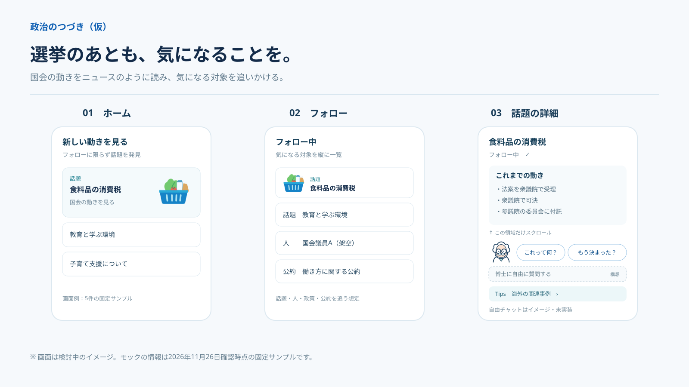

# 政治のつづき（仮）

> 第2案のたたき台。名称・機能・提供範囲は検討中。モックの情報は確認日時を示した固定サンプルで、自動更新されません。

## ■yk2b0yuka-blip

### (1) アイデア名

政治のつづき（仮）

### 解決する課題

選挙時に気になった政策や公約について、その後の国会の動きや関連する資料を追いたくても、情報が分散し、難しい言葉や調べ続ける手間によって、前回からの変化をつかみにくい。[課題一覧](../../../analysis/kazy/課題一覧_若者と政治教育.md)の8-①（分からないことへの不安）・9-⑤（調べるコスト）に関係する。実際の頻度や、このアプリで負担が減るかは要検証。

### 既存プロダクトの有無

近いサービスは既にある。[あゆみ for 国会](https://www.ayumi-kokkai.jp/changelog)は政党の公約・進捗や法案の賛否を掲載し、[GIIN](https://apps.apple.com/jp/app/giin-%E3%82%AE%E3%82%A4%E3%83%B3-%E5%9B%BD%E4%BC%9A%E8%AD%B0%E4%BA%8B%E9%8C%B2-ai%E8%A6%81%E7%B4%84-%E6%94%BF%E6%B2%BB%E5%AD%A6%E7%BF%92-%E8%AD%B0%E5%93%A1/id6758155810)は議員・キーワードのフォローと国会発言の閲覧を提供している。[公約ウォッチ](https://www.koyaku-watch.com/)は公約と発言・行動を記録している。人・話題のフォローや公約の追跡は既存の要素であり、本案の独自性は未検証。

### ペルソナ

選挙やニュースで気になる話題・政治家ができたものの、選挙後に何を調べればよいか分からず、議事録や制度の言葉も難しく感じている人。年齢は限定しない。具体的な利用者像は検討中。

### キャッチコピー

選挙のあとも、気になることを。（仮）

### アプリ概要（30秒でいうと）

話題・人・政党・公約から気になるものをフォローし、国会での動きをニュースのように読む。詳しい経緯や原文をたどれ、分からないときは用意された質問を博士に押して聞ける。自由な質問をAIに相談する機能も検討する。Tipsから関連する国内外の事例も見られる。

### その他アプリ機能

- **ホーム**：フォロー状況に限らず、話題や政策、人などの新しい動きを見る。モックは最新情報ではなく5件の固定表示例。
- **フォロー・検索**：話題・人・政党・公約を登録し、フォロー欄で縦に一覧する。投票先の入力は求めず、気になる対象として選ぶ。ニュースは更新を伝える記事で、トレンドは探索の入口とする想定。
- **国会の動き**：話題に関係する提出・審議・採決などの確認できた事実を詳細画面に時系列で表示。発言・提案・決定・実施は区別し、公約達成を機械的に断定しない。モックでは、この経緯だけを独立してスクロールする。
- **博士に聞く**：話題の詳細で「これって何？」「もう決まった？」などの定型質問を押し、短い回答と出典を確認する。
- **自由チャット（機能案）**：定型質問に加え、利用者が自分の言葉で博士に質問し、AIと対話できる形を検討する。回答の根拠・更新時点・誤りの扱い、異なる立場をどう示すか、会話の取り扱いと実装範囲は未決定。モックとコンセプト画像では入力欄のイメージのみで、実際のAI対話や送信は未実装。
- **Tips**：話題の詳細画面にある小さなバナーに国内外の関連事例の見出しを表示。数秒ごとに切り替え、押した時点の見出しを開く。詳細の下には別の事例を並べる。出典・対象・時点・違いを示し、政策効果を単純に同一視しない。
- **原文・確認時点**：情報源、更新・確認時点を示す。情報が見つからないことを、活動していないことと扱わない。
- **将来の展開**：国会を対象にした後、地方議会・自治体に広げることも検討する。

### 使うオープンデータ

候補は[国立国会図書館の国会会議録検索API](https://kokkai.ndl.go.jp/api.html)の会議・発言データ。公約、議案の経過、採決、制度の実施状況、国内外の事例は別の情報源も必要で、収集・更新・対応付けと利用条件の確認は未完了。

モックでは[衆議院の議案審議経過](https://www.shugiin.go.jp/Internet/itdb_gian.nsf/html/gian/keika/1DE342E.htm)と[OECDの税制改革資料](https://www.oecd.org/en/publications/tax-policy-reforms-2026_43d18a55-en/full-report/tax-policy-reforms_82075677.html)などを手作業で参照し、2026年11月26日確認時点の固定サンプルを掲載。API連携や自動更新はしていない。

### 未成年向けだから成立する理由

11月21日の議事録に沿い、年齢を限定しない。難しい用語を短く説明し、少しずつ追える体験は未成年を含む政治に詳しくない人にも役立つ可能性があるが、対象者への検証は未実施。

### 課題との紐づき

- 情報の所在や経緯が分かりにくい → フォローした対象に関わる動き・出典・経過をまとめる。
- 用語や状況を理解する自信がない（8-①） → 定型質問から短い説明と原文へ進める。
- 調べる手間が大きい（9-⑤） → 気になる対象と関連する記事・Tipsへの入口を用意する。ただし負担が実際に減るかは未検証。

### 期待効果

選挙後も気になる話題を追い、前に見た情報と新しい動きを結びつけるきっかけになることを期待する。利用者が経緯・情報源を把握できたか、また読みたいと思うかを確認したい。効果・利用者数・コスト削減額は未測定。

### 画面イメージ（あれば）

[コンセプト画像](concept-v3.svg)／[画像のPNG版](concept-v3-preview.png)／[操作できるモック](mock/index.html)。スマートフォンの縦画面を想定。

モックのホームにはフォローに依存しない5件の表示例、フォロー一覧には登録済み話題と4件の表示例を縦に並べる。詳細があるのは「食料品の消費税」の固定サンプル1件で、博士への2つの質問・Tipsを常に表示し、「これまでの動き」は独立してスクロールする。「さがす」からのフォロー追加・解除も試せる。買い物と博士のイラストはコンセプト画像の雰囲気に合わせて描き直したSVG。人・政党・公約の実データは未収録。Tipsは6秒で自動切り替え、手動選択も可能（端末の動きを減らす設定に従う）。通知、ログイン、保存、ライブデータ、自由質問、地方議会は未実装。

## 方針・検討事項

- 国会全体を対象にする構想だが、初期実装の具体的な収録範囲は未決定。地方は将来の候補。
- 国政の情報だけではUDCの地域課題との関係が伝わりにくい可能性がある。地域での利用場面・波及効果を、コンテスト要件とともに確認する。
- 表示範囲・更新頻度、資料の権利、誤りの訂正、偏りへの配慮、フォロー情報の保存方法などは要検討。
